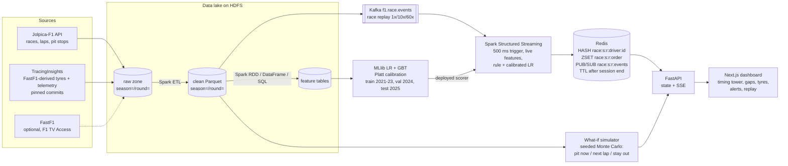

# F1 Strategy Analytics at Scale

An end-to-end big-data pipeline that asks one race-strategy question at scale: **when a car pits to undercut
the car ahead, does it come out in front?** It builds a partitioned, multi-season (2021–2025) Formula 1 data
lake and turns it into decision-time features with Spark (RDD, DataFrame and SQL). Those features train a
calibrated MLlib model of undercut success. Races are then replayed through Kafka and Spark Structured
Streaming, which flag undercut opportunities lap by lap. Live state goes through Redis to a FastAPI + Next.js
dashboard, where a Monte Carlo what-if simulator compares *pit now*, *pit next lap* and *stay out* from the same
race state.

**Why.** An undercut is a pit stop timed to gain track position on fresh tyres. Whether it works depends on
the gap, tyre age and degradation, the pit-lane loss, out-lap pace and traffic, and all of that changes lap by
lap. The project uses that question to exercise the whole big-data stack:
- a lake partitioned by season and race;
- distributed feature engineering;
- a model evaluated strictly chronologically, with a sealed test season;
- an event-driven serving path with measured latency;
- benchmarks of how the Spark jobs scale and what partitioning and caching buy.

IISc MTech DA231o course project by team **Data Wranglers**. Every proposal commitment is mapped to code in
[docs/traceability.md](docs/traceability.md), and CI checks that every file named there exists.

## Contents
- [Architecture](#architecture)
- [Quick start: the sample demo](#quick-start-the-sample-demo)
- [Full-data mode](#full-data-mode)
- [Reproducing the experiments](#reproducing-the-experiments)
- [Key results](#key-results)
- [Limitations](#limitations)
- [Data licensing](#data-licensing)
- [Team, course and citation](#team-course-and-citation)

## Architecture



| Layer | Code | Details |
|---|---|---|
| Ingestion (rate-limited, cached, resumable) | `src/f1sa/ingest/` | [architecture.md#ingestion](docs/architecture.md#ingestion-srcf1saingest) |
| Lake, clean zone, Spark ETL and features | `src/f1sa/{lake,etl,features}/` | [architecture.md](docs/architecture.md), [data_dictionary.md](docs/data_dictionary.md) |
| Undercut label and model | `src/f1sa/model/` | [label_definition.md](docs/label_definition.md), [model_spec.md](docs/model_spec.md), [model_spec_v2.md](docs/model_spec_v2.md) |
| Kafka + Structured Streaming | `src/f1sa/streaming/` | [architecture.md#streaming](docs/architecture.md#streaming-streaming-step-12) |
| Redis serving contract | `src/f1sa/serving/` | 9-field hash, order zset, events channel, TTL (tested in `tests/unit/test_keys.py`) |
| API and dashboard | `src/f1sa/api/`, `web/` | FastAPI docs at `/api/docs` |
| What-if simulator | `src/f1sa/sim/` | [sim_spec.md](docs/sim_spec.md) (pre-registered) |
| Benchmarks | `src/f1sa/bench/`, `experiments/` | [experiments.md](docs/experiments.md) |

## Quick start: the sample demo

The demo runs on the committed sample: two races (2023 R5 and 2024 R5) of real Jolpica laps and pit stops with
**synthetic** tyres and telemetry (`is_synthetic=true`). It needs no credentials, no HDFS and no Java on the
host. The dashboard always shows a **SYNTHETIC DEMO DATA** banner.

### Prerequisites

| | Windows 11 + WSL 2 | Linux / macOS |
|---|---|---|
| Docker | Docker Desktop with WSL integration for your distro | Docker Engine or Docker Desktop, Compose v2 (`docker compose`) |
| Tools in the shell | `git`, GNU `make`, [`uv`](https://docs.astral.sh/uv/) (installs Python 3.12 itself) | the same (macOS: `make` from the Xcode command line tools) |
| Memory for Docker | `memory=12GB` or more in `%UserProfile%\.wslconfig`, then `wsl --shutdown` | 12 GB or more available to Docker |
| Disk | about 15 GB free (images: app 7.2 GB, web 0.4 GB, kafka 0.7 GB, redis 0.2 GB) | the same |
| Free ports | 3000 (web), 8000 (api), 9092 (kafka), 6379 (redis) on 127.0.0.1 | the same |

- **WSL 2: clone inside the Linux file system** (for example `~/code`), not under `/mnt/c`. Bind mounts and
  Spark are much slower across the Windows boundary.
- **Memory.** The core profile's container limits add up to about 9.6 GiB (kafka 768 MiB, redis 384 MiB, app
  6 GiB, api 2 GiB, web 512 MiB). The demo itself uses far less, and the full table is in
  [architecture.md#memory-budget](docs/architecture.md#memory-budget).
- **User id.** Without a `.env`, `make` builds the app image for your user id (`id -u`), so the containers can
  write `data/` and `models/`. To change ports or the user id, copy `.env.example` to `.env`.

### Run it

```bash
git clone https://github.com/parinithd-27/F1-Strategy-Analytics.git
cd F1-Strategy-Analytics
make up            # core profile: kafka, redis, app, api, web (builds the images the first time)
make sample-data   # validates data/sample offline
make demo          # sample pipeline + sample model + a 60x replay of 2024 R5
```

On the dev host, a clean clone took **5 min 57 s** for an image build without cache plus
`make up && make sample-data && make demo` (`make demo` alone: 103 s). Base images and package caches were warm, so
a first run on a new machine also pays for the downloads ([reproduce.md §4](docs/reproduce.md#4-timing-of-a-fresh-clone)).

`make demo` prints `Dashboard: http://localhost:3000/race/2024/5  (SYNTHETIC DEMO DATA)`. Open it while the replay
runs (about 2 minutes at 60x). Start another replay from the page, or run `make demo-replay`. Use `localhost`,
not `127.0.0.1`: it is the API's CORS origin.

What `make demo` does. Every Spark step runs in the `app` container:
1. Sample ETL into `data/lake/clean` and the Spark feature jobs into `data/lake/features`. The undercut counts go
   to `data/demo/<run>/`, never to `results/`.
2. Builds the **sample deployment model** `models/undercut/sample_deploy_real_G3.5_k2/`, which is what the stream job
   scores with.
   - It is the frozen procedure trained on the one sample training race and stamped SMOKE TEST.
   - Its probabilities are not findings.
   - The real deployment model is built from the full lake (`make model-save-full`) and is not part of the demo.
3. Builds the what-if tyre model `models/sim/tyre_model_sample.json`.
4. Recreates only the `api` container (replay on, sample model).
5. Starts the replay. It waits until all 20 cars are in Redis, then prints the URL.

Stop everything with `make down`. It removes the containers and keeps the volumes. `make demo-clean` lists the demo
outputs under `data/demo`.

## Full-data mode

Full mode builds the 2021–2025 lake in HDFS (90 races) and needs `make up-full`, which adds the namenode, datanode,
HttpFS, a Spark master and two workers. Give Docker about 14 GB. Step-by-step commands, outputs and the
targets that write `results/` are in **[docs/reproduce.md](docs/reproduce.md)**.

1. **Jolpica-F1** (races, results, qualifying, pit stops, laps):
   `DATA_LAKE_URI=hdfs://namenode:8020/f1 uv run f1sa-ingest season-range --seasons 2021-2025 --sources jolpica --sink hdfs`.
   - It runs at most 4 requests/s and 450 requests/h, so the whole range takes **about 3 h**.
   - Responses are cached and the run can be resumed (`data/manifest.json`, `--only-failed`). `--dry-run` prints
     the plan and an ETA.
2. **TracingInsights** (FastF1-derived compounds, tyre life, race control and per-lap telemetry): `make ingest-ti-full`.
   - Files are downloaded at the commits pinned in `src/f1sa/ingest/tracinginsights_pins.json`, and each one is
     checked against its git blob id.
   - It is resumable. `SKIP_RAW_TELEMETRY=1` keeps no raw 2024 samples.
3. **FastF1, optional.** Since October 2026 FastF1 needs an **F1 TV Access** login (`F1_USERNAME`, `F1_PASSWORD`
   in the environment, never committed). Without one it returns empty sessions, and the loaders fail loudly. The
   project's results use TracingInsights instead.
4. **Clean zone, features and model.** `make pipeline-full` and `make etl-ti-full` build them. `make model-dev-full`
   runs development on 2021–2024. `make model-save-full` saves the deployment model, which never reads 2025. The
   single 2025 test run, `make model-test-full CONFIRM=yes`, is pre-registered and refuses to run twice.
5. **Serve the full lake:** `make api-up FULL=1 REPLAY=1`.

## Reproducing the experiments

Every experiment is a make target. Targets with `RECORD=1` write `results/` and refuse to overwrite an existing
file. Without `RECORD`, they write only to `data/`. `make experiments` (full lake) and `make experiments-sample`
rerun every regenerable generator in a sandbox and compare each output byte for byte with the committed
`results/`. They never write `results/`. Method, runtime and limits are in [docs/experiments.md](docs/experiments.md).

| Experiment (traceability #) | Command | Runtime on the dev host | Outputs |
|---|---|---|---|
| Model evaluation, chronological split, calibration (#29, #39) | `make model-dev-full`; the 2025 test run `make model-test-full CONFIRM=yes` (once) | 211 s per development run (both settings) | `results/model_dev_*`, `results/model_eval_*`, `results/calibration_*` |
| Paired ablation intervals (#30) | `make ablation-full RECORD=1` | 1 min 45 s | `results/ablation_paired.{csv,png}` |
| ORACLE out-lap variant, development data only (#30) | `make oracle-dev-full RECORD=1` | 2 min 49 s | `results/model_dev_{eval,loso}_oracle*.csv` |
| Spark scalability, 1/3/5 seasons (#27, #33, #38) | `make experiments-spark RECORD=1 GRID_ARGS="..."` (overnight, nothing else running) | hours | `results/scalability.csv`, `scalability_{build,telemetry}.png` |
| Partitioning and caching (#28, #34) | part of `make experiments-spark` | about 0.5 h (estimate) | `results/partitioning.csv`, `partitioning_speedup.png` |
| Streaming replay latency, throughput, resources (#31, #35, #36, #38) | `make stream-latency-suite RECORD=1` (core profile only) | 28 min 28 s | `results/streaming_*` |
| UI render latency (#35) | `make api-up DEBUG=1 UI_LATENCY_CSV=data/demo/ui_latency/ui_latency.csv`, then `make stream-latency-ui RECORD=1` | 2 min 9 s | `results/ui_latency*.csv` |
| Redis latency at streaming rates (#37) | `make redis-latency RECORD=1` | 3 min 31 s | `results/redis_latency_quiet.csv` |
| What-if consistency + backtest (#32, #40) | `make whatif-consistency-full RECORD=1` | 17 s (development run) | `results/whatif_consistency.{csv,png}` |
| Regeneration check (all non-2025 generators) | `make experiments` / `make experiments-sample` | 19 min 26 s / 1 min 27 s | `data/experiments/<run_id>/summary.txt` |

## Key results

All numbers are copied from the committed results and their write-ups. The first two sections are on the
held-out **2025** season, which was evaluated once:
- 49 labelled undercut attempts in 19 races at the primary setting (G = 3.5 s, k = 2);
- base rate 0.347;
- 95% race-cluster bootstrap intervals, 1000 resamples.

**No significance claim is made**, and the per-model intervals overlap. Details: [docs/model_results.md](docs/model_results.md).

### Undercut model vs baselines (2025, primary setting)

| Model | PR-AUC [95% CI] | Brier [95% CI] | ROC-AUC [95% CI] | F1 positive class [95% CI] | ECE, 10 bins [95% CI] |
|---|---|---|---|---|---|
| **Calibrated LR, feature set `real` (primary)** | **0.670 [0.421, 0.898]** | **0.177 [0.106, 0.232]** | 0.792 [0.667, 0.929] | 0.571 [0.323, 0.778] | 0.107 [0.076, 0.234] |
| Rule baseline | 0.513 [0.246, 0.799] | 0.273 [0.168, 0.353] | 0.702 [0.516, 0.860] | 0.357 [0.000, 0.542] | 0.258 [0.162, 0.360] |
| Majority-class baseline | 0.347 [0.162, 0.517] | 0.229 | 0.500 | 0.000 | 0.051 |

- The primary model scores better than the rule baseline on every metric, but every interval overlaps.
- Against the majority baseline (#17): F1 0.571 against 0.000, and PR-AUC 0.670 against 0.347.

### Ablation: tyre and telemetry inputs (paired 2025 intervals)
- **Method:** the frozen models scored again, with one shared set of race resamples for all feature sets
  (`results/ablation_paired.csv`).
- **Most differences are not distinguishable from zero.** 46 of the 48 paired intervals contain 0. The two
  exceptions are both calibrated LR at the primary setting:
  - `real_ti − real` ROC-AUC: −0.062 [−0.126, −0.015];
  - `real_ti − real_tyre` Brier: +0.014 [+0.002, +0.026].

  With 48 intervals, one or two that exclude 0 are expected by chance, so neither is read as a finding.
- **PR-AUC, calibrated LR:**
  - `real_tyre − real`: +0.021 [−0.136, +0.128];
  - `real_ti − real`: −0.040 [−0.205, +0.072].

  Adding per-lap telemetry points the same way as in development: lower PR-AUC and ROC-AUC, higher Brier.
- **Conclusion:** on this 2025 sample the tyre and telemetry inputs do not improve the model. The primary feature
  set and the deployed model are unchanged, as pre-registered.

### What-if simulator: consistency and its 2025 calibration weakness
Source: `results/whatif_consistency.csv`. The checks are pre-registered in [docs/sim_spec.md](docs/sim_spec.md).

**Pre-registered checks:**
- **Monotonicity:** passes. A larger pit loss for the attacker never raises P(`pit_now`): 0 of 155 states have an
  increase.
- **Determinism:** passes. The same seed gives byte-identical results in 157 of 157 states, and seed + 1 moves P
  by at most 0.06.
- **Ordering:** 17 of 18 pass/fail rows pass.
  - The failing cell is in the far tail: opening at −0.5 s/lap with a 5 s gap, P(`pit_next_lap`) − P(`pit_now`)
    = +0.022.
  - The extra simulated lap widens the spread, which lifts a small tail probability even though the mean gap
    worsens.
  - The rule was kept unchanged, and the failure is part of the result.

**Backtest of P(`pit_now`) against the real outcomes:**

| Subset | Attempts | Simulator Brier | Simulator ECE, 10 bins | Simulator mean P | Observed rate | Model Brier | Model ECE, 10 bins |
|---|---|---|---|---|---|---|---|
| 2021–2024 (development) | 155 | 0.185 | 0.090 | 0.295 | 0.303 | 0.152 (157; its own training and calibration rows) | 0.058 |
| **2025 (held out)** | 49 | **0.245** | **0.207** | **0.395** | 0.347 | 0.177 | 0.107 |

**The weakness.** On 2025 the simulator is clearly worse calibrated than in development:
- it over-predicts success (mean P 0.395 against an observed 0.347);
- its ECE is more than twice the development value;
- the sensitivity response is worse still (Brier 0.242, ECE 0.242, mean P 0.458).

The calibrated model stays better calibrated than the simulator on 2025. Read the simulator's probabilities as
a comparison between strategies from the same state, not as calibrated odds.

### Streaming, UI and Redis latency (quiet stack, 2024 R5 replay)
From [docs/experiments.md](docs/experiments.md). Steady state, without the first batch:

| Segment | 1x (15 min) p50 / p95 / p99 | 10x p50 / p95 / p99 | 60x p50 / p95 / p99 |
|---|---|---|---|
| Produced → Pub/Sub (end to end) | 729 / 1039 / 1115.4 ms | 786.5 / 1227.0 / 1586.5 ms | 798 / 1461.5 / 1757 ms |
| Redis write → SSE client | p50 2 / p99 5.4 ms | p50 2 / p99 8 ms | p50 2 / p99 5 ms |

- **Where the time goes.** The 500 ms trigger and the Kafka hop take about 0.73–0.80 s of the median. Every
  serving hop is a few milliseconds.
- **The first race batch costs about 1.3–1.4 s more.** It loads the priors once per race.
- **UI, 60x:** API SSE send → browser paint is p50 / p95 / p99 28 / 37 / 40 ms, and produced → paint is
  855 / 1519.5 / 3443.5 ms.
- **Throughput** equals the produced rate: 12.71 messages/s at 60x, with no backlog. The pipeline's maximum was not
  load-tested.
- **Redis**, serving contract at 60 batches/s on a quiet stack:
  - write p50 / p95 / p99 1.21 / 1.59 / 1.78 ms, HGETALL 0.18 / 0.32 / 0.41 ms;
  - 0 late ticks, and every p99 below 3.1 ms.

### Spark scalability, partitioning and caching (single host)
From [docs/experiments.md](docs/experiments.md). All medians are on one 12-CPU WSL 2 VM, so read them as trends.

**Telemetry aggregation** over the real 2024 samples (1.94 GB):
- the cost grows about linearly with the data;
- all 24 rounds take 18.01 s on `local[1]`, 7.49 s on `local[4]` (2.40x) and 8.24 s on the 2-worker cluster
  (2.19x).

**Feature build:**
- **Fixed overhead dominates at small sizes.** Going from 1 to 5 real seasons multiplies the lap rows by 4.7, but
  the `local[4]` time only by 1.37 (48.0 → 65.8 s).
- **At 3 seasons x4 (synthetic replication):**
  - `local[1]` 257.8 s, `local[4]` 200.5 s;
  - the cluster was fastest at 161.9 s [160.9, 164.8], 1.59x over `local[1]`.
- **The largest cells:** at 1 season x16 and 5 seasons x4, every `local[N]` cell was stopped by the memory guard.
  The cluster finished them (175.6 s and 213.6 s), with an executor lost and recovered in each run.

**Partitioning** with `partitionBy(season, round)`, laps x16:
- One-race queries are 1.74x faster on file:// and 1.20x on HDFS (against unpartitioned on the same file system).
- Full scans and joins get slower because of the many small files: 0.30x and 0.32x on file://, 0.14x and 0.12x on
  HDFS against the simplest baseline.

**Caching:**
- `cache()` helps only the small lap queries: 1.41x on one race. Materialising the cache takes 1.13 s, so it pays
  back only after roughly 25–40 such queries.
- It does not help telemetry.
- `persist(DISK_ONLY)` is mostly slower than no caching.

## Limitations

- **Small test season.** With 49 labelled attempts in 19 races, the 2025 intervals are wide. No difference
  between models or feature sets is claimed as significant.
- **Single host.** Every "node" is a container on one VM: no network shuffle, no HDFS data locality (one datanode),
  and a shared page cache, so timed runs read warm. Larger lap inputs are synthetic copies with shifted keys, so
  skew and cardinality are idealised.
- **Data gaps.**
  - Jolpica has no per-lap timestamps: they are estimated, and every row is flagged.
  - Sample-mode tyres and telemetry are synthetic.
  - FastF1 now needs F1 TV Access, so real tyres and telemetry come from TracingInsights, whose compound coverage
    is low for some races (2025 Miami R6: 55.6% of laps).
- **Streaming** was measured at replay rates of at most about 13 events/s, on one host with one clock. The
  dashboard's charts start when the page connects, because Pub/Sub keeps no history.
- **What-if.**
  - Calibration on 2025 is weak (above).
  - The pre-registered ordering check fails in one far-tail cell.
  - Traffic is third cars only.
  - The new compound after a stop follows a fixed rule.
- **The demo model** is a smoke-test model trained on one sample race. It shows the plumbing, not model quality.

The open issues of every step are listed in [docs/PROGRESS.md](docs/PROGRESS.md) under "Known issues".

## Data licensing

- **Code:** MIT ([LICENSE](LICENSE)).
- **Data:** each source keeps its own terms ([DATA_LICENSES.md](DATA_LICENSES.md)).
  - **Jolpica-F1** is CC BY-NC-SA 4.0 (non-commercial, attribution, share-alike). Only the small sample in
    `data/sample/` is committed.
  - **Formula 1 timing data** (through FastF1 or TracingInsights) is owned by Formula 1 / FOM. It is used for
    private academic study only and is never committed or redistributed.
  - The sample's tyres and telemetry are **synthetic** and marked `is_synthetic=true`.

## Team, course and citation

- **Team Data Wranglers:** Parinith D., Dakshinesh K., Rohan Deore, Kaushal V.
- **Course:** DA231o, MTech, Indian Institute of Science (IISc), Bengaluru.
- **Cite:** [CITATION.cff](CITATION.cff) (GitHub shows "Cite this repository").

### For developers

```bash
make setup                 # uv sync --all-extras
make lint typecheck test   # ruff, mypy, Python unit tests (Java 17 needed on the host for Spark tests)
make web-test              # dashboard lint, typecheck, Vitest
uv run python scripts/check_traceability.py
```

- **CI** (`.github/workflows/ci.yml`) runs these checks. It also runs an end-to-end job on the core profile:
  `make up`, `make sample-data`, `make demo DEMO_WAIT=finished` and the Playwright smoke test.
- **Integration tests** (`tests/integration`, which need `make up-full`) are run by hand. See
  [docs/reproduce.md](docs/reproduce.md).
- Progress and known issues: [docs/PROGRESS.md](docs/PROGRESS.md).
