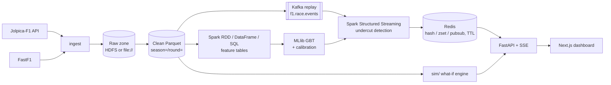

# Architecture

This is a skeleton. Each section is filled in by the step that builds that layer (see [traceability.md](traceability.md)).

## Modules (`src/f1sa/`)
| Package | Responsibility |
|---|---|
| `ingest` | Jolpica client (rate-limited, cached, resumable) and FastF1 loader |
| `lake` | Paths, schemas and writers for the raw and clean zones |
| `etl` | Spark jobs that demonstrate the RDD, DataFrame and SQL APIs |
| `features` | Gap change, tyre age, out-lap pace, pit loss, telemetry aggregates, undercut label |
| `model` | Chronological split, GBT training, calibration, explanation, baselines |
| `streaming` | Kafka producer (race replay), Structured Streaming job, Redis sink |
| `serving` | Redis key contract and store (TTL on session end) |
| `sim` | What-if race simulation (pit now / pit next lap / stay out) |
| `api` | FastAPI routes and the SSE stream for the dashboard |

## Rules
- Storage root comes **only** from `f1sa.config.Settings.data_lake_uri`. No other module hardcodes paths or endpoints.
- Features for lap *L* use only information available at the end of lap *L-1* (see `docs/label_definition.md`, added in S8).
- Data is split chronologically: train on 2021–2023, validate and calibrate on 2024, test on 2025.

## Local infrastructure (Docker Compose)
Defined in `docker-compose.yml`, project name `f1sa`. `make up` starts `core`; `make up-full` starts `full` (core + hdfs + spark). `make down` stops all containers and **keeps volumes**. `make nuke CONFIRM=yes` is the only target that deletes volumes.

| Profile | Service | Image | Host port | Internal address |
|---|---|---|---|---|
| core | kafka (KRaft, single node) | `apache/kafka:4.3.2` | 9092 (`PLAINTEXT_HOST`) | `kafka:29092` |
| core | kafka-init (one-shot: creates `f1.race.events`, 3 partitions) | `apache/kafka:4.3.2` | n/a | n/a |
| core | redis (no persistence, `maxmemory 256mb`, `volatile-ttl`) | `redis:8.10.3` | 6379 | `redis:6379` |
| core | app (Python 3.12 + locked deps + Spark Kafka connector) | `f1sa-app:dev` (from `docker/spark/Dockerfile`) | n/a | n/a |
| hdfs | namenode | `f1sa-hadoop:3.4.3` (from `apache/hadoop:3.4.3`) | 9870 (web UI) | `hdfs://namenode:8020` |
| hdfs | datanode | `f1sa-hadoop:3.4.3` | n/a | `datanode:9864` |
| spark | spark-master (standalone) | `f1sa-app:dev` | 8080 (UI) | `spark://spark-master:7077` |
| spark | spark-worker-1, spark-worker-2 | `f1sa-app:dev` | 8081, 8082 (UI) | n/a |

- Host ports 3000 and 8000 are reserved for the web app and the API (later steps). Every host port can be overridden in `.env` (see `.env.example`). If you change `KAFKA_HOST_PORT` or `REDIS_HOST_PORT`, update `KAFKA_BOOTSTRAP` and `REDIS_URL` to match.
- The app image installs `spark-sql-kafka-0-10_2.13:4.2.1` (plus `kafka-clients`, `spark-token-provider-kafka` and `commons-pool2`) into `$SPARK_HOME/jars` at build time, so Structured Streaming needs no network at runtime. Inside containers, Kafka is `kafka:29092`. From the host, it is `localhost:9092`.
- HDFS is a single-node dev setup: `dfs.replication=1` and permissions disabled (`docker/hadoop/`). The NameNode is formatted on first start only.

### Memory budget
The Docker Desktop WSL 2 VM is capped by `memory=` in the Windows file `%UserProfile%\.wslconfig`. On the dev machine the VM currently has about 9 GiB and 6 CPUs (`free -g`, `nproc`). Each container has a hard `mem_limit`:

| Container | Limit | Notes |
|---|---|---|
| kafka | 768 MiB | JVM heap 512 MiB |
| kafka-init | 512 MiB | exits after creating the topic |
| redis | 384 MiB | dataset capped at 256 MiB (`maxmemory`) |
| app | 1.5 GiB | driver for local Spark jobs |
| namenode | 768 MiB | heap ≤ 512 MiB |
| datanode | 768 MiB | heap ≤ 512 MiB |
| spark-master | 512 MiB | daemon heap 256 MiB |
| spark-worker-1, -2 | 1.5 GiB each | `SPARK_WORKER_MEMORY=1g` for executors + 256 MiB daemon |
| **core total** | **≈ 2.6 GiB** | |
| **full total** | **≈ 7.6 GiB** (limits) | measured idle use is ≈ 1.6 GiB |

These are ceilings, not reservations. If the full profile runs into memory pressure, lower `SPARK_WORKER_MEMORY` and `SPARK_WORKER_CONTAINER_MEM` in `.env`, or raise `memory=` in `.wslconfig` and run `wsl --shutdown`.
