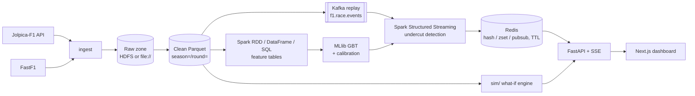

# Architecture

This is a skeleton. Each section is filled in by the step that builds that layer (see [traceability.md](traceability.md)).

## Modules (`src/f1sa/`)
| Package | Responsibility |
|---|---|
| `ingest` | Jolpica client (rate-limited, cached, resumable) and FastF1 loader |
| `lake` | Paths, schemas and writers for the raw and clean zones |
| `etl` | Spark jobs that demonstrate the RDD, DataFrame and SQL APIs |
| `features` | Gap change, tyre age, out-lap pace, pit loss, telemetry aggregates, undercut label |
| `model` | Chronological split, GBT training, calibration, explanation, baselines |
| `streaming` | Kafka producer (race replay), Structured Streaming job, Redis sink |
| `serving` | Redis key contract and store (TTL on session end) |
| `sim` | What-if race simulation (pit now / pit next lap / stay out) |
| `api` | FastAPI routes and the SSE stream for the dashboard |

## Rules
- Storage root comes **only** from `f1sa.config.Settings.data_lake_uri`. No other module hardcodes paths or endpoints.
- Features for lap *L* use only information available at the end of lap *L-1* (see `docs/label_definition.md`, added in S8).
- Data is split chronologically: train on 2021–2023, validate and calibrate on 2024, test on 2025.
