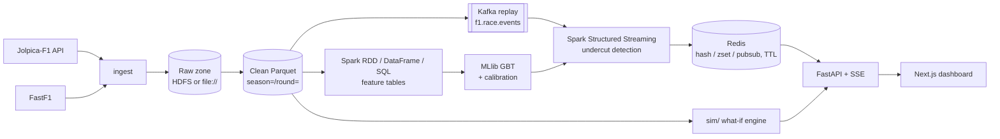

# Architecture

This is a skeleton. Each section is filled in by the step that builds that layer (see [traceability.md](traceability.md)).



## Modules (`src/f1sa/`)
| Package | Responsibility |
|---|---|
| `ingest` | Jolpica client (rate-limited, cached, resumable) and FastF1 loader |
| `lake` | Paths, schemas and writers for the raw and clean zones |
| `etl` | Spark jobs that demonstrate the RDD, DataFrame and SQL APIs |
| `features` | Gap change, tyre age, out-lap pace, pit loss, telemetry aggregates, undercut label |
| `model` | Chronological split, GBT training, calibration, explanation, baselines |
| `streaming` | Kafka producer (race replay), Structured Streaming job, Redis sink |
| `serving` | Redis key contract and store (TTL on session end) |
| `sim` | What-if race simulation (pit now / pit next lap / stay out) |
| `api` | FastAPI routes and the SSE stream for the dashboard |

## Rules
- Storage root comes **only** from `f1sa.config.Settings.data_lake_uri`. No other module hardcodes paths or endpoints.
- Features for lap *L* use only information available at the end of lap *L-1* (see `docs/label_definition.md`, added in S8).
- Data is split chronologically: train on 2021–2023, validate and calibrate on 2024, test on 2025.

## Local infrastructure (Docker Compose)
Defined in `docker-compose.yml`, project name `f1sa`. `make up` starts `core`; `make up-full` starts `full` (core + hdfs + spark). `make down` stops all containers and **keeps volumes**. `make nuke CONFIRM=yes` is the only target that deletes volumes.

| Profile | Service | Image | Host port | Internal address |
|---|---|---|---|---|
| core | kafka (KRaft, single node) | `apache/kafka:4.3.2` | 9092 (`PLAINTEXT_HOST`) | `kafka:29092` |
| core | kafka-init (one-shot: creates `f1.race.events`, 3 partitions) | `apache/kafka:4.3.2` | n/a | n/a |
| core | redis (no persistence, `maxmemory 256mb`, `volatile-ttl`) | `redis:8.10.3` | 6379 | `redis:6379` |
| core | app (Python 3.12 + locked deps + Spark Kafka connector) | `f1sa-app:dev` (from `docker/spark/Dockerfile`) | n/a | n/a |
| hdfs | namenode | `f1sa-hadoop:3.4.3` (from `apache/hadoop:3.4.3`) | 9870 (web UI) | `hdfs://namenode:8020` |
| hdfs | datanode | `f1sa-hadoop:3.4.3` | n/a | `datanode:9864` |
| hdfs | httpfs (HDFS REST gateway that proxies bytes, used by the HDFS sink) | `f1sa-hadoop:3.4.3` | 14000 | `http://httpfs:14000/webhdfs/v1` |
| spark | spark-master (standalone) | `f1sa-app:dev` | 8080 (UI) | `spark://spark-master:7077` |
| spark | spark-worker-1, spark-worker-2 | `f1sa-app:dev` | 8081, 8082 (UI) | n/a |

- Host ports 3000 and 8000 are reserved for the web app and the API (later steps). Every host port can be overridden in `.env` (see `.env.example`). If you change `KAFKA_HOST_PORT` or `REDIS_HOST_PORT`, update `KAFKA_BOOTSTRAP` and `REDIS_URL` to match.
- The app image installs `spark-sql-kafka-0-10_2.13:4.2.1` (plus `kafka-clients`, `spark-token-provider-kafka` and `commons-pool2`) into `$SPARK_HOME/jars` at build time, so Structured Streaming needs no network at runtime. Inside containers, Kafka is `kafka:29092`. From the host, it is `localhost:9092`.
- HDFS is a single-node dev setup: `dfs.replication=1` and permissions disabled (`docker/hadoop/`). The NameNode is formatted on first start only.

### Memory budget
The Docker Desktop WSL 2 VM is capped by `memory=` in the Windows file `%UserProfile%\.wslconfig`. On the dev machine the VM currently has about 9 GiB and 6 CPUs (`free -g`, `nproc`). Each container has a hard `mem_limit`:

| Container | Limit | Notes |
|---|---|---|
| kafka | 768 MiB | JVM heap 512 MiB |
| kafka-init | 512 MiB | exits after creating the topic |
| redis | 384 MiB | dataset capped at 256 MiB (`maxmemory`) |
| app | 1.5 GiB | driver for local Spark jobs |
| namenode | 768 MiB | heap ≤ 512 MiB |
| datanode | 768 MiB | heap ≤ 512 MiB |
| httpfs | 384 MiB | heap ≤ 256 MiB |
| spark-master | 512 MiB | daemon heap 256 MiB |
| spark-worker-1, -2 | 1.5 GiB each | `SPARK_WORKER_MEMORY=1g` for executors + 256 MiB daemon |
| **core total** | **≈ 2.6 GiB** | |
| **full total** | **≈ 8.0 GiB** (limits) | measured idle use is ≈ 1.6 GiB (before httpfs) |

These are ceilings, not reservations. If the full profile runs into memory pressure, lower `SPARK_WORKER_MEMORY` and `SPARK_WORKER_CONTAINER_MEM` in `.env`, or raise `memory=` in `.wslconfig` and run `wsl --shutdown`.

## Ingestion (`src/f1sa/ingest/`)
`f1sa-ingest season-range --seasons 2021-2025 --sources jolpica,fastf1 --sink file|hdfs [--dry-run] [--only-failed]`
(`f1sa-ingest race --season S --round R ...` is the same code path limited to one round).

### Raw zone layout (table first, Hive-style partitions)
Root = `DATA_LAKE_URI` (`file://./data/lake` or `hdfs://namenode:8020/f1`).
```
raw/jolpica/schedule/season=S/schedule.json                  # season-level: fetched once per season
raw/jolpica/drivers/season=S/drivers.json
raw/jolpica/constructors/season=S/constructors.json
raw/jolpica/results/season=S/round=R/results.json            # per race weekend
raw/jolpica/qualifying/season=S/round=R/qualifying.json
raw/jolpica/pitstops/season=S/round=R/pitstops.json
raw/jolpica/laps/season=S/round=R/laps.json
raw/jolpica/sprint_results/season=S/round=R/sprint_results.json   # sprint weekends only
raw/fastf1/laps/season=S/round=R/laps.parquet
raw/fastf1/session/season=S/round=R/session.json
raw/fastf1/telemetry/season=S/round=R/driver=VER/car_data.parquet  # Speed, Throttle, Brake, nGear, RPM
raw/fastf1/position/season=S/round=R/driver=VER/position.parquet
```
- Jolpica files are the JSON pages exactly as received (`[page, page, ...]`). The `parse_*` functions in
  `jolpica_client.py` turn them into typed DataFrames.
- Every partition has a `_manifest.json` with the files, rows, sha256, source URL, licence and `is_synthetic=false`.
- Each table is its own partitioned dataset, so Spark (S5/S6) can read `raw/<source>/<table>/` directly.

### Sinks (`ingest/sinks.py`)
Both sinks have the same interface (`write_bytes/json/parquet`, `write_manifest`, `exists`, `cleanup_temp`) and the
same guarantees:
- **Atomic.** Bytes go to a temporary name and are renamed onto the final name only when complete.
- **Repeatable.** Writing a name again replaces the file.
- **Verifiable.** Each write returns size and sha256 to the ingestion manifest.
- **Clean.** Temp files are removed on any failure, including Ctrl+C. `cleanup_temp()` removes leftovers from a
  killed process before a partition is rewritten.

| Sink | Temp name | Commit | Notes |
|---|---|---|---|
| `FileSink` (`file://`) | `.<name>.<random>.tmp` | fsync, then `os.replace` | files are mode 0644 |
| `HdfsSink` (`hdfs://`) | `_tmp.<uuid>.<name>` | `CREATE ...&data=true`, length check, then (`DELETE` old) + `RENAME` | via **HttpFS** |

`HdfsSink` details:
- It talks to the HttpFS gateway (`HDFS_HTTPFS_URL`: `http://localhost:14000` from the host, `http://httpfs:14000` in
  containers). HttpFS streams the bytes itself, so clients never follow WebHDFS redirects to `datanode:9864`, which the
  WSL host cannot resolve.
- Verified on 3.4.3: `RENAME` onto an existing file answers HTTP 200 with `{"boolean": false}`, and
  `renameoptions=OVERWRITE` is ignored. Replacing a file is therefore DELETE + RENAME, and the boolean is always checked.
- Connection errors and 5xx (for example NameNode safe mode) are retried with exponential backoff. 4xx fails
  immediately.
- The `hdfs://host:port` authority in `DATA_LAKE_URI` only names the path. HttpFS uses its own configured
  `fs.defaultFS`.
- `--sink` must match the scheme of `DATA_LAKE_URI`, for example
  `DATA_LAKE_URI=hdfs://namenode:8020/f1 f1sa-ingest ... --sink hdfs`.

### Ingestion manifest (`data/manifest.json`, `ingest/manifest.py`)
- One item per `sink:source:season:round` (or `...:season` for the season tables). Each item holds its status
  (`pending/running/done/failed/interrupted/skipped`), attempts, timestamps, error text (≤ 2 KB) and its files
  (URI, rows, bytes, sha256).
- The manifest is rewritten atomically after **every** status change (temp file, fsync, `os.replace`, then fsync of the
  directory). A kill at any moment leaves the old or the new version, never a torn file. This is tested with a real
  SIGKILL.
- An item still `running` on load belongs to a dead process and is retried.
- `flock` on `manifest.json.lock` stops concurrent runs.
- Resume:
  - The default run processes everything that isn't `done`.
  - `--only-failed` processes `failed` items only.
  - Races not yet run (race date ≥ today) are `skipped` and picked up later.
- Failures:
  - `FastF1AuthError` or `FastF1RateLimitError` aborts the run at once (exit 3). Sign-in is checked before any work.
  - Any other per-item error is recorded and the run continues (exit 1).
  - Ctrl+C or SIGTERM marks the item `interrupted` and exits 130.
  - Items are fetched and validated completely before their first file is written.

### Rate budget
- **Jolpica** allows 4 req/s and 500 req/h per IP. `DualRateLimiter` sits in the transport adapter, so cache hits
  are free:
  - **Per second:** a token bucket with capacity 1, refilled at 3/s, gives at most 4 requests in *any* 1-s window.
  - **Per hour:** a sliding-window log gives at most `JOLPICA_MAX_PER_HOUR` (default 450) in *any* rolling hour. It is
    persisted to `JOLPICA_CACHE_DIR/requests.log`, so resumed and back-to-back runs share one hourly budget.
  - Why not plain token buckets: a bucket of capacity C refilled at R admits C + R·T requests in a window T. The
    Step 3 buckets (4 + 4/s and 450 + 450/h) allowed 8 requests in one second and about 900 in the first hour. The
    real 2021 run hit 63 HTTP 429s from the per-second case before this was fixed.
  - A 429 without `Retry-After` backs off 5, 10, 20, 40 s (capped at 60 s). 5xx and connection errors back off from
    1 s. `Retry-After` is honoured when sent.
  - The SQLite HTTP cache at `JOLPICA_CACHE_DIR` never expires. Pages are `limit=100` (the server caps it); for laps,
    `total` counts *timings*, so pages split laps and are merged by lap number.
- **FastF1** makes its own Jolpica calls (about 3 per race) and about 10 livetiming calls per race. It also raises
  at its own hard limits (200/h jolpi.ca, 500/h overall).
- When **both** sources run:
  - Our Jolpica client gets `450 − 3 × FASTF1_MAX_RACES_PER_HOUR` (default 390/h).
  - FastF1 races are paced to `FASTF1_MAX_RACES_PER_HOUR` (default 20).
  - The passes run one after the other (all Jolpica, then FastF1).
- The plan and the budget split are printed before every run. `--dry-run` stops there. Its only network use is at most
  one schedule request per season.

### FastF1 specifics (`ingest/fastf1_loader.py`)
- `Cache.configure(cache_dir=FASTF1_CACHE_DIR)`, which **must be inside `./data`** (enforced). Nothing from FastF1 is
  written outside `data/` locally.
- The F1 TV token stays at FastF1's default `~/.local/share/fastf1/` (deny-listed for the assistant, never in the repo,
  never mounted into containers).
- Empty laps raise `FastF1AuthError`. Missing telemetry or columns raise `FastF1DataError`.
- Races are loaded and written one at a time, one driver partition after another. The session is dropped and
  `gc.collect()` runs before the next race, so at most one race is in memory.
