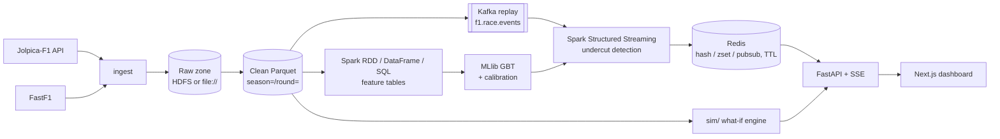
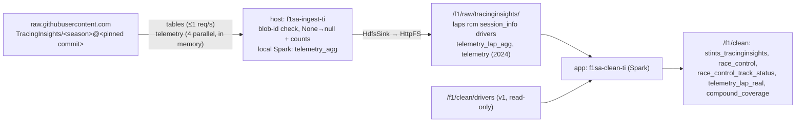

# Architecture

This is a skeleton. Each section is filled in by the step that builds that layer (see [traceability.md](traceability.md)).



## Modules (`src/f1sa/`)
| Package | Responsibility |
|---|---|
| `ingest` | Jolpica client (rate-limited, cached, resumable) and FastF1 loader |
| `lake` | Paths, schemas and writers for the raw and clean zones |
| `etl` | Spark jobs that demonstrate the RDD, DataFrame and SQL APIs |
| `features` | Gap change, tyre age, out-lap pace, pit loss, telemetry aggregates, undercut label |
| `model` | Chronological split, GBT training, calibration, explanation, baselines |
| `streaming` | Kafka producer (race replay), Structured Streaming job, Redis sink |
| `serving` | Redis key contract and store (TTL on session end) |
| `sim` | What-if race simulation (pit now / pit next lap / stay out) |
| `api` | FastAPI routes and the SSE stream for the dashboard |

## Rules
- Storage root comes **only** from `f1sa.config.Settings.data_lake_uri`. No other module hardcodes paths or endpoints.
- Features for lap *L* use only information available at the end of lap *L-1* (see `docs/label_definition.md`).
- Data is split chronologically: train on 2021–2023, validate and calibrate on 2024, test on 2025.

## Local infrastructure (Docker Compose)
Defined in `docker-compose.yml`, project name `f1sa`. `make up` starts `core`; `make up-full` starts `full` (core + hdfs + spark). `make down` stops all containers and **keeps volumes**. `make nuke CONFIRM=yes` is the only target that deletes volumes.

| Profile | Service | Image | Host port | Internal address |
|---|---|---|---|---|
| core | kafka (KRaft, single node) | `apache/kafka:4.3.2` | 9092 (`PLAINTEXT_HOST`) | `kafka:29092` |
| core | kafka-init (one-shot: creates `f1.race.events`, 3 partitions) | `apache/kafka:4.3.2` | n/a | n/a |
| core | redis (no persistence, `maxmemory 256mb`, `volatile-ttl`) | `redis:8.10.3` | 6379 | `redis:6379` |
| core | app (Python 3.12 + locked deps + Spark Kafka connector) | `f1sa-app:dev` (from `docker/spark/Dockerfile`) | n/a | n/a |
| core | api (FastAPI, `python -m f1sa.api`, Step 13) | `f1sa-app:dev` | 127.0.0.1:8000 only (`API_HOST_PORT`) | `api:8000` |
| core | web (Next.js dashboard, Step 14; non-root, read-only root fs) | `f1sa-web:dev` (from `docker/web/Dockerfile`) | 127.0.0.1:3000 only (`WEB_HOST_PORT`) | `web:3000` |
| hdfs | namenode | `f1sa-hadoop:3.4.3` (from `apache/hadoop:3.4.3`) | 9870 (web UI) | `hdfs://namenode:8020` |
| hdfs | datanode | `f1sa-hadoop:3.4.3` | n/a | `datanode:9864` |
| hdfs | httpfs (HDFS REST gateway that proxies bytes, used by the HDFS sink) | `f1sa-hadoop:3.4.3` | 14000 | `http://httpfs:14000/webhdfs/v1` |
| spark | spark-master (standalone) | `f1sa-app:dev` | 8080 (UI) | `spark://spark-master:7077` |
| spark | spark-worker-1, spark-worker-2 | `f1sa-app:dev` | 8081, 8082 (UI) | n/a |

- The web app publishes 3000 and the API 8000, both on the host's 127.0.0.1 only. Every host port can be overridden in `.env` (see `.env.example`). If you change `KAFKA_HOST_PORT` or `REDIS_HOST_PORT`, update `KAFKA_BOOTSTRAP` and `REDIS_URL` to match.
- The app image installs `spark-sql-kafka-0-10_2.13:4.2.1` (plus `kafka-clients`, `spark-token-provider-kafka` and `commons-pool2`) into `$SPARK_HOME/jars` at build time, so Structured Streaming needs no network at runtime. Inside containers, Kafka is `kafka:29092`. From the host, it is `localhost:9092`.
- HDFS is a single-node dev setup: `dfs.replication=1` and permissions disabled (`docker/hadoop/`). The NameNode is formatted on first start only.
- The app container mounts the repo read-only at `/workspace`, with `data/`, `results/` and `models/` (Step 9c) mounted read-write over it.
- The api container mounts the repo and `data/` read-only, with `data/demo` and `data/checkpoints` read-write on top (a replay's outputs and stream-job state), `results/` read-write (`ui_latency.csv`) and `models/` read-only. `make up`, `up-full` and `api-up` create the two host folders first, because Docker would otherwise create them owned by root. A write anywhere else under `/workspace/data` fails with EROFS (checked: `manifest.json`).

### Memory budget
The Docker Desktop WSL 2 VM is capped by `memory=` in the Windows file `%UserProfile%\.wslconfig`. On the dev machine the VM currently has about 9 GiB and 6 CPUs (`free -g`, `nproc`). Each container has a hard `mem_limit`:

| Container | Limit | Notes |
|---|---|---|
| kafka | 768 MiB | JVM heap 512 MiB |
| kafka-init | 512 MiB | exits after creating the topic |
| redis | 384 MiB | dataset capped at 256 MiB (`maxmemory`) |
| app | 1.5 GiB | driver for local Spark jobs |
| api | 2 GiB | uvicorn (≈ 100 MiB) + one replay: stream job JVM + producer JVM (measured peaks 1.33 and 1.49 GiB) |
| web | 512 MiB | Next.js standalone server (`node server.js`) |
| namenode | 768 MiB | heap ≤ 512 MiB |
| datanode | 768 MiB | heap ≤ 512 MiB |
| httpfs | 384 MiB | heap ≤ 256 MiB |
| spark-master | 512 MiB | daemon heap 256 MiB |
| spark-worker-1, -2 | 1.5 GiB each | `SPARK_WORKER_MEMORY=1g` for executors + 256 MiB daemon |
| **core total** | **≈ 5.1 GiB** | ≈ 2.6 GiB before the api (Step 13) and web (Step 14) services |
| **full total** | **≈ 10.5 GiB** (limits) | needs the WSL VM raised to 14 GB (`memory=14GB` in `.wslconfig`, being done by the user); measured idle use is ≈ 1.6 GiB (before httpfs and api) |

These are ceilings, not reservations. If the full profile runs into memory pressure, lower `SPARK_WORKER_MEMORY` and `SPARK_WORKER_CONTAINER_MEM` in `.env`, or raise `memory=` in `.wslconfig` and run `wsl --shutdown`.

## Ingestion (`src/f1sa/ingest/`)
`f1sa-ingest season-range --seasons 2021-2025 --sources jolpica,fastf1 --sink file|hdfs [--dry-run] [--only-failed]`
(`f1sa-ingest race --season S --round R ...` is the same code path limited to one round).

### Raw zone layout (table first, Hive-style partitions)
Root = `DATA_LAKE_URI` (`file://./data/lake` or `hdfs://namenode:8020/f1`).
```
raw/jolpica/schedule/season=S/schedule.json                  # season-level: fetched once per season
raw/jolpica/drivers/season=S/drivers.json
raw/jolpica/constructors/season=S/constructors.json
raw/jolpica/results/season=S/round=R/results.json            # per race weekend
raw/jolpica/qualifying/season=S/round=R/qualifying.json
raw/jolpica/pitstops/season=S/round=R/pitstops.json
raw/jolpica/laps/season=S/round=R/laps.json
raw/jolpica/sprint_results/season=S/round=R/sprint_results.json   # sprint weekends only
raw/fastf1/laps/season=S/round=R/laps.parquet
raw/fastf1/session/season=S/round=R/session.json
raw/fastf1/telemetry/season=S/round=R/driver=VER/car_data.parquet  # Speed, Throttle, Brake, nGear, RPM
raw/fastf1/position/season=S/round=R/driver=VER/position.parquet
```
- Jolpica files are the JSON pages exactly as received (`[page, page, ...]`). The `parse_*` functions in
  `jolpica_client.py` turn them into typed DataFrames.
- Every partition has a `_manifest.json` with the files, rows, sha256, source URL, licence and `is_synthetic=false`.
- Each table is its own partitioned dataset, so Spark (S5/S6) can read `raw/<source>/<table>/` directly.

### Sinks (`ingest/sinks.py`)
Both sinks have the same interface (`write_bytes/json/parquet`, `write_manifest`, `exists`, `cleanup_temp`) and the
same guarantees:
- **Atomic.** Bytes go to a temporary name and are renamed onto the final name only when complete.
- **Repeatable.** Writing a name again replaces the file.
- **Verifiable.** Each write returns size and sha256 to the ingestion manifest.
- **Clean.** Temp files are removed on any failure, including Ctrl+C. `cleanup_temp()` removes leftovers from a
  killed process before a partition is rewritten.

| Sink | Temp name | Commit | Notes |
|---|---|---|---|
| `FileSink` (`file://`) | `.<name>.<random>.tmp` | fsync, then `os.replace` | files are mode 0644 |
| `HdfsSink` (`hdfs://`) | `_tmp.<uuid>.<name>` | `CREATE ...&data=true`, length check, then (`DELETE` old) + `RENAME` | via **HttpFS** |

`HdfsSink` details:
- It talks to the HttpFS gateway (`HDFS_HTTPFS_URL`: `http://localhost:14000` from the host, `http://httpfs:14000` in
  containers). HttpFS streams the bytes itself, so clients never follow WebHDFS redirects to `datanode:9864`, which the
  WSL host cannot resolve.
- Verified on 3.4.3: `RENAME` onto an existing file answers HTTP 200 with `{"boolean": false}`, and
  `renameoptions=OVERWRITE` is ignored. Replacing a file is therefore DELETE + RENAME, and the boolean is always checked.
- Connection errors and 5xx (for example NameNode safe mode) are retried with exponential backoff. 4xx fails
  immediately.
- The `hdfs://host:port` authority in `DATA_LAKE_URI` only names the path. HttpFS uses its own configured
  `fs.defaultFS`.
- `--sink` must match the scheme of `DATA_LAKE_URI`, for example
  `DATA_LAKE_URI=hdfs://namenode:8020/f1 f1sa-ingest ... --sink hdfs`.

### Ingestion manifest (`data/manifest.json`, `ingest/manifest.py`)
- One item per `sink:source:season:round` (or `...:season` for the season tables). Each item holds its status
  (`pending/running/done/failed/interrupted/skipped`), attempts, timestamps, error text (≤ 2 KB) and its files
  (URI, rows, bytes, sha256).
- The manifest is rewritten atomically after **every** status change (temp file, fsync, `os.replace`, then fsync of the
  directory). A kill at any moment leaves the old or the new version, never a torn file. This is tested with a real
  SIGKILL.
- An item still `running` on load belongs to a dead process and is retried.
- `flock` on `manifest.json.lock` stops concurrent runs.
- Resume:
  - The default run processes everything that isn't `done`.
  - `--only-failed` processes `failed` items only.
  - Races not yet run (race date ≥ today) are `skipped` and picked up later.
- Failures:
  - `FastF1AuthError` or `FastF1RateLimitError` aborts the run at once (exit 3). Sign-in is checked before any work.
  - Any other per-item error is recorded and the run continues (exit 1).
  - Ctrl+C or SIGTERM marks the item `interrupted` and exits 130.
  - Items are fetched and validated completely before their first file is written.

### Rate budget
- **Jolpica** allows 4 req/s and 500 req/h per IP. `DualRateLimiter` sits in the transport adapter, so cache hits
  are free:
  - **Per second:** a token bucket with capacity 1, refilled at 3/s, gives at most 4 requests in *any* 1-s window.
  - **Per hour:** a sliding-window log gives at most `JOLPICA_MAX_PER_HOUR` (default 450) in *any* rolling hour. It is
    persisted to `JOLPICA_CACHE_DIR/requests.log`, so resumed and back-to-back runs share one hourly budget.
  - Why not plain token buckets: a bucket of capacity C refilled at R admits C + R·T requests in a window T. The
    Step 3 buckets (4 + 4/s and 450 + 450/h) allowed 8 requests in one second and about 900 in the first hour. The
    real 2021 run hit 63 HTTP 429s from the per-second case before this was fixed.
  - A 429 without `Retry-After` backs off 5, 10, 20, 40 s (capped at 60 s). 5xx and connection errors back off from
    1 s. `Retry-After` is honoured when sent.
  - The SQLite HTTP cache at `JOLPICA_CACHE_DIR` never expires. Pages are `limit=100` (the server caps it); for laps,
    `total` counts *timings*, so pages split laps and are merged by lap number.
- **FastF1** makes its own Jolpica calls (about 3 per race) and about 10 livetiming calls per race. It also raises
  at its own hard limits (200/h jolpi.ca, 500/h overall).
- When **both** sources run:
  - Our Jolpica client gets `450 − 3 × FASTF1_MAX_RACES_PER_HOUR` (default 390/h).
  - FastF1 races are paced to `FASTF1_MAX_RACES_PER_HOUR` (default 20).
  - The passes run one after the other (all Jolpica, then FastF1).
- The plan and the budget split are printed before every run. `--dry-run` stops there. Its only network use is at most
  one schedule request per season.

### FastF1 specifics (`ingest/fastf1_loader.py`)
- `Cache.configure(cache_dir=FASTF1_CACHE_DIR)`, which **must be inside `./data`** (enforced). Nothing from FastF1 is
  written outside `data/` locally.
- The F1 TV token stays at FastF1's default `~/.local/share/fastf1/` (deny-listed for the assistant, never in the repo,
  never mounted into containers).
- Empty laps raise `FastF1AuthError`. Missing telemetry or columns raise `FastF1DataError`.
- Races are loaded and written one at a time, one driver partition after another. The session is dropped and
  `gc.collect()` runs before the next race, so at most one race is in memory.

## TracingInsights source (`ingest/tracinginsights_*.py`, `etl/clean_tracinginsights.py`, Step 4C)
FastF1 needs an F1 TV login since Oct 2026, so tyres, race control, exact track status and telemetry come from the
TracingInsights season repositories (audit: `docs/data_source_audit.md`). FastF1 stays as an optional path.



- **Reproducible:** commits are pinned in `ingest/tracinginsights_pins.json`, together with the git blob ids of the
  four table files of every race. Telemetry blob ids come from a blob-free fetch of the pinned tree (a few MB,
  cached in `data/cache/tracinginsights/trees`). Every body is checked against its blob id before anything is
  written. sha256s go into each partition's `_manifest.json` and into `data/manifest_tracinginsights.json`, which is
  resumable, uses `--only-failed`, and is separate from `data/manifest.json`.
- **Telemetry (B4):**
  - one race at a time: download into memory, put the samples on the session clock (`lST + time`, ms), drop the
    boundary sample that consecutive lap files share (keeping the later lap's copy), then aggregate with the
    unchanged `telemetry_agg.assign_to_laps` + `aggregate_samples`;
  - only the aggregates are kept, plus `n_samples` and a coverage flag (`none` / `partial`: span < 90% or a gap
    > 2 s / `full`);
  - raw samples are kept for 2024 only (`--skip-raw-telemetry`);
  - peak local disk ≈ 0. A disk guard checks free space on `/mnt/c` (the Windows drive backing WSL) and refuses
    below 20 GB.
- **Additive:** the new clean tables live in `lake/schemas_tracinginsights.py`, and `etl.clean` never reads them.
  The v1 stints precedence (FastF1 → synthetic → inferred), the neutralisation flag and every v1 table are
  unchanged. A test runs v1 clean with and without TI raw data present and compares the checksums.

### HDFS replication
The cluster has one datanode, but the PySpark Hadoop client in the app image (no `HADOOP_CONF_DIR`) used Hadoop's
default `dfs.replication=3`. So every block written by the Spark jobs (`/f1/clean`, `/f1/features`; 1,936 blocks)
was under-replicated, while HttpFS (which reads `hdfs-site.xml`, replication 1) wrote `/f1/raw` correctly.
`etl.spark.build_spark` now passes `spark.hadoop.dfs.replication` from `HDFS_REPLICATION` (default 1), and
`HdfsSink` sends `replication` on CREATE explicitly. Existing files keep their factor until
`hdfs dfs -setrep -R 1 /f1` is run, which changes metadata only and leaves contents and checksums alone.

## Sample mode (`data/sample/`, Step 4B)
- `make sample-data` validates the bundle **offline**, or builds it if it is missing (`REBUILD=1` to force).
- The bundle is a mini raw lake with the raw-zone layout: real Jolpica pages for 2023 R5 and 2024 R5 plus
  **SYNTHETIC** `raw/synthetic/{tyre_stints,lap_telemetry}` (`is_synthetic=true`, seeded, deterministic). It contains
  no FastF1 data and is under 5 MB (about 0.5 MB). See `docs/data_dictionary.md`.
- Building reads each page from the raw zone, then the HTTP cache, then the network. The network path goes through
  the shared, flock-protected rate-limit log, so it is safe next to a running bulk ingestion. The bundle is assembled
  in `data/sample.tmp-<pid>`, validated, then swapped in.
- Validation checks sha256 and size, schemas, `is_synthetic`, no FastF1, unlisted files and the size limit, and that
  the synthetic tables regenerate byte-identically from the recorded seed.
- Consumers read the bundle read-only and write elsewhere. For example, the clean job's `--source sample` writes to
  `{DATA_LAKE_URI}/clean`, so derived output never lands in the tracked `data/sample/`.

## Clean zone (`etl/clean.py`, `lake/schemas.py`, `lake/quality.py`, Step 5)
```
raw (Jolpica JSON pages, FastF1 Parquet, synthetic Parquet)
  --Spark: explicit schemas, explode, normalise ids, times -> seconds, gaps, track flags-->
clean/{races,drivers,constructors,results,qualifying,laps,pitstops,stints,telemetry_lap,telemetry_raw}/season=S/round=R/
  + clean/_quality/report.json
```
- **Input**:
  - `--source sample` reads `data/sample/raw` (read-only).
  - `--source lake` reads `{DATA_LAKE_URI}/raw` (file:// or hdfs://).
  - FastF1 data is optional and used per race when present (exact track status, real stints and telemetry).
- **Output**: `{DATA_LAKE_URI}/clean/{table}/`, Parquet, `partitionBy("season","round")`, `mode=overwrite` with
  `spark.sql.sources.partitionOverwriteMode=dynamic`.
  - A rerun replaces only the partitions it writes, so it is **idempotent**: identical per-table content checksums
    are printed and stored in the report.
  - A run over a subset of races leaves the other partitions untouched.
  - In file mode the job refuses to write outside `./data/lake` (gitignored), and Spark scratch goes to
    `data/lake/.spark-tmp`.
- **Reading pandas Parquet**: `spark.sql.legacy.parquet.nanosAsLong=true` lets Spark read FastF1's nanosecond
  timestamps and durations as `long`; the job converts them explicitly.
- **Quality**: hard checks fail the job (exit 1), and soft checks are reported. See `docs/data_dictionary.md`.
- **Run modes**:
  - **file, on the host**: `make etl-sample`, or
    `DATA_LAKE_URI=file://$PWD/data/lake uv run python -m f1sa.etl.clean --source sample`. Spark runs `local[2]`.
  - **hdfs, inside the app container**. The container can resolve `namenode` and `datanode`; the host cannot:
    ```bash
    docker compose exec app env PYTHONPATH=/workspace/src DATA_LAKE_URI=hdfs://namenode:8020/f1 \
        python -m f1sa.etl.clean --source lake
    ```
    `PYTHONPATH` points at the mounted repo (`/workspace`, read-only), so the current code runs without rebuilding
    the image. Spark runs `local[2]` inside the 1.5 GiB app limit. `--master spark://spark-master:7077` switches to
    the standalone cluster (planned for S10). *Not verified yet: waiting for the bulk HDFS ingest to finish.*

## Feature jobs (`etl/rdd_jobs.py`, `etl/df_jobs.py`, `etl/sql/*.sql`, `etl/sql_jobs.py`, `features/`, Step 6)
```
clean/{races,drivers,constructors,results,laps,pitstops,stints}   (one directory per table; _quality/ is never read)
  --RDD / DataFrame / Spark SQL-->
features/{laps_enriched,gaps,stints,lap_time_distribution,pit_loss,team_outlap_history,race_summary}/season=S/round=R/
```
`uv run python -m f1sa.features.build --source sample` (or `make features-sample`, or `f1sa-features`).

- `--source sample` builds the races in `data/sample` and fails if one of them is missing from the clean zone
  (run `make etl-sample` first). `--source lake` builds every race in the clean zone.
- Output uses `partitionBy(season, round)` with dynamic overwrite, so a rerun gives identical checksums. In file mode
  the job refuses to write outside `./data/lake`.
- Every table is read back after writing, and the job checks that each target race has a partition and that
  `laps_enriched` has exactly one row per clean lap.

### Where each Spark API is used, and why
| API | Job | Why this API |
|---|---|---|
| **RDD** | `rdd_stints`: `keyBy((season, round, driver))`, then `groupByKey`, then a Python sort of each driver's laps and a split after every pit-in lap that is not the last lap | Stint splitting is a sequential scan over one driver's ordered laps. With an RDD, that is ordinary Python code over a grouped iterator, with no window tricks. One driver has at most about 70 laps, so `groupByKey` is cheap here. |
| **RDD** | `rdd_lap_time_distribution`: `aggregateByKey` over (season, round, circuit) with a custom accumulator (n, mean, M2, min, max, 1-s histogram), combined with Chan's parallel update | It shows a user-defined, mergeable aggregate: partial results are combined on each partition before the shuffle. Welford/Chan keeps the variance stable. The circuit lookup is a broadcast variable. |
| **DataFrame** | `enrich_laps`: joins of laps, results, pit stops (aggregated per lap first), drivers, constructors, stints (a range join on `lap BETWEEN start_lap AND end_lap`) and races; windows for cumulative time, gaps, `lag` changes, tyre age and laps remaining | These are relational joins and window functions, which Catalyst optimises (column pruning, broadcast joins of the small dimension tables, a shared window sort). Every right side is deduplicated on its join key, so the output has exactly one row per lap. |
| **Spark SQL** | `pit_loss_prior`, `team_outlap_prior`, `race_summary` (and the views they build on) | The rules against leakage sit in one readable window frame, `RANGE BETWEEN UNBOUNDED PRECEDING AND 1 PRECEDING` over `race_seq = season*100 + round`. A reviewer can audit that in the `.sql` file without reading Python. |

Each RDD job has a DataFrame implementation of the same logic (`df_stints`, `df_lap_time_distribution`). The tests
assert that the two are equal row for row:
- stints: exact equality, and both also equal the clean stints table on the sample (100/100 rows);
- the distribution: counts, min, max and histograms are exact, and mean and std agree to 1e-9 relative, because
  floating-point sums depend on the order of addition.

### Gaps at the timing line
- `gap_leader_s` = cumulative time − the cumulative time of the car in P1 **at the same lap number**.
  - A lapped car is compared with the time when the leader completed that same lap, not with the leader's position
    when the lapped car crossed the line.
  - So the value is the true time behind and can be longer than a lap. For example, a car lapped at lap 4 is 106 s
    behind in the test fixture, where a lap takes 90 s.
- `gap_ahead_s` is the gap to the car one position ahead at the same lap number. `ahead_driver_id` names that car.
- `gap_*_change_{1,3}l` is the value now minus the value k laps earlier.
  - It is null when the earlier row is not exactly lap − k.
  - For `gap_ahead_change_*`, it is also null when the car ahead is a different driver, so the change always means
    "closing on, or dropping back from, the same car".
- Cumulative time becomes null from the first lap with an unknown time, and every gap that depends on it is null
  too.
- The recomputed gaps equal the clean-zone gaps exactly on the sample (2168/2168 laps).

### Estimated lap timestamps (an approximation)
Jolpica has no per-lap timestamps. `df_jobs.lap_timestamps` estimates them:
```
lap_end_utc   = race_start_utc + START_OFFSET_S + cumulative_time_s      (START_OFFSET_S = 180 s)
lap_start_utc = lap_end_utc - lap_time_s
```
`lap_time_estimated = true` on every row. `race_start_utc` is the scheduled start, which is when the formation lap
begins. Lights out is usually about 2.5 to 4 minutes later, so 180 s is a fixed middle value. Limits:
- **Error of about ±1 minute or more:**
  - the formation lap takes longer or shorter than 180 s;
  - extra formation laps, aborted starts and delayed starts are not modelled;
  - a start behind the safety car changes the timing.
- **Red flags:** Jolpica's lap time for the suspended lap includes the stoppage, so later timestamps stay roughly
  consistent with the wall clock. The exact split inside that lap is unknown.
- **Unknown start time:** Jolpica sometimes has no start time, and the clean zone then stores 00:00:00 UTC. Both
  timestamps are null in that case, as they are when the cumulative time is unknown.
- **Precision:** inherited from the 1 ms lap times. Errors from missing laps add up, which is why the cumulative time
  is null after a missing lap.
- **Intended use:** ordering and replay pacing (S12). They are not wall-clock truth. FastF1's `LapStartTime` is exact
  when it is available.

### Leakage-safe history (pit loss, team out-lap delta)
- **Per stop** (`pit_cycles.sql`):
  - Pit loss = in-lap + out-lap − 2 × the driver's green median lap. The green median comes from
    `driver_green_pace.sql` and needs at least 5 green laps.
  - Out-lap delta = out-lap − the driver's green median lap.
  - Stops are skipped when:
    - the stop is long (more than 60 s);
    - it is on lap 1;
    - there is no out-lap (a stop on the last lap, or a retirement);
    - the in-lap or out-lap is neutralised or red-flag;
    - the in-lap or out-lap overlaps another pit cycle;
    - a lap time is unknown;
    - the driver has no reference pace.
- **Per race:**
  1. Each race (or each race and constructor) gets one row with its own values in an array.
  2. `flatten(collect_list(vals)) OVER (… ORDER BY race_seq RANGE BETWEEN UNBOUNDED PRECEDING AND 1 PRECEDING)`
     collects the values of strictly earlier races only.
  3. The median of the sorted array is taken with the same linear interpolation as Spark's `median`.

  Spark does not allow `median()` with a window frame, which is why the arrays are used.
- **Fallbacks** use data from earlier races only, never from the current race or a later one:

  | Table | Fallback order | Flag columns |
  |---|---|---|
  | `pit_loss` | circuit prior → global prior → null | `pit_loss_source ∈ {circuit_prior, global_prior, none}`, `pit_loss_missing` |
  | `team_outlap_history` | team prior → circuit prior (all teams) → global prior → null | `outlap_source ∈ {team_prior, circuit_prior, global_prior, none}`, `outlap_missing` |

- History is computed over **all** races in the clean zone and then filtered to the target races. A partial rebuild
  therefore gives the same values as a full one.
- On the sample:
  - 2023 R5 (miami) → `none`.
  - 2024 R5 (shanghai, a new circuit) → `global_prior`, from 2023 R5 only.
  - Team out-laps for 2024 → `team_prior`. Renamed teams (alphatauri → rb, alfa → sauber) get `global_prior`,
    because `constructor_id` changes on a rename.
- Tests: a 4-race fixture with known medians. The data of the target race and every later race is scaled ×100, and
  the target's history is asserted unchanged.

### Time semantics for the model (S8)
A feature row for lap L describes the state **at the end of lap L**. The undercut model must use the information
available at the end of lap L − 1, so it joins the lap L − 1 row (gaps, tyre age, laps remaining). Pit-loss and
out-lap history rows are known before the race starts. `race_summary` and `lap_time_distribution` describe the whole
race, so they are reporting tables and must never be joined as features of the same race.

## Telemetry, out-lap pace and team lineage (`features/telemetry_agg.py`, `outlap.py`, `lineage.py`, Step 7)
- **Telemetry is batch only.** `telemetry_agg` is a DataFrame `groupBy(season, round, driver_id, lap)` job.
  - There is one definition, at full throttle ≥ 98%. The clean zone's FastF1 path calls it too, so the clean and
    feature tables cannot disagree.
  - Samples are assigned to laps by session time in `[lap_start, lap_end)`. The windows come from the new nullable
    clean-laps columns `lap_start_session_s` and `lap_end_session_s`, filled from FastF1.
  - A race with real `telemetry_raw` is aggregated from raw. Any other race passes its clean `telemetry_lap` rows
    through unchanged, keeping `is_synthetic`.
  - Streaming code never imports telemetry, and a test enforces this.
- **Out-lap pace** (definitions in `docs/label_definition.md`):
  - `realised_outlap_delta_s` is an ORACLE value (it uses laps after the stop).
  - `expected_outlap_delta_s` is the decision-time feature: the mean over strictly earlier races, computed with
    `rangeBetween(unboundedPreceding, -1)` on `race_seq`.
  - Fallback order: driver+team → team → circuit → global → null, with a flag column.
  - Like Step 6, history is computed over all clean races and then filtered to the targets.
- **Lineage:** `features/lineage.py` holds `LINEAGE` (alphatauri → rb, alfa → sauber) and `STABLE_CONSTRUCTORS`.
  - Team history (the SQL `team_outlap_history` through a `constructor_lineage` view, and `outlap_features` through
    `with_history_key`) is keyed by the lineage key.
  - The build fails when a clean-zone constructor id is in neither set, so a missed rename cannot silently split a
    team's history.
  - The list is verified on the sample only. It is to be checked against the full 2021–2025 data.

## Undercut attempts and the real-time detector (`features/undercut_rule.py`, `undercut.py`, `streaming/detector.py`, Step 8)
- **One rule, two callers.** `features/undercut_rule.py` is pure Python, with no Spark, pandas or py4j import (a
  subprocess test enforces this). `candidate_pairs(LapSnapshot, RuleParams)` returns every candidate pair at the end of
  a lap, with the reasons it fails:
  - `streaming/detector.detect` keeps the eligible pairs (opportunities before any stop);
  - `features/undercut.evaluate_race` keeps the pairs whose attacker pits on the next lap and evaluates the outcome
    window.

  `tests/unit/test_undercut.py` checks, on every scenario, lap and G, that the detector's flagged pairs (with A
  pitting on L) equal the batch attempts that have `detector_eligible`.
- **Distribution.** Per race, the batch job runs the pure-Python evaluation through the RDD API:
  `keyBy(season, round)` on the lap rows and the pit stops, `cogroup`, then `flatMap(evaluate_race)`. A race is about
  1,200 lap rows, so it fits in one task, and races are independent. Decision-time features are DataFrame windows over
  `laps_enriched` (stint-to-date pace and degradation) plus joins to `pit_loss` and `outlap_features`, made at the
  decision lap L − 1.
- **Grid.** All 9 (G, k) combinations are emitted in one run. `undercut_attempts` is a sparse table, so a target race
  with no attempts gets its stale partition deleted instead of being required.
- **Smoke-test counts.** `--source sample` also writes `results/undercut_counts_sample.csv` (smoke test only).
- **Out-lap plan size.** `outlap_features` reuses the realised out-lap table four times. A `localCheckpoint()` cuts
  its lineage; without it the optimised plan grew to about 13 MB and the test JVM ran out of heap.

## Undercut model (`model/`, `experiments/model_eval.py`, Step 9)
```
undercut_attempts + stints + telemetry_lap_features --dataset.load_attempts--> one (G, k), labelled rows
  --build_dataset--> train 2021-23 | validation 2024 | SealedSplit(test 2025)
  --train.tune (grid; fit on train, PR-AUC on validation)--> LR (assembler, scaler, LR) and GBT pipelines
  --calibrate.choose (validation scores)--> isotonic or Platt (Platt below 300 rows) or identity
  --evaluate.evaluate_test (opens the test split once)--> metrics plus race-cluster and attempt bootstrap CIs
  --explain--> GBT importances, standardised LR coefficients, validation permutation importance
```
- **Metrics** (`model/metrics.py`) are numpy, so tuning, evaluation, the bootstrap and permutation importance share
  one implementation.
  - PR-AUC is average precision; it does not interpolate like Spark's `areaUnderPR`.
  - ROC-AUC matches Spark's `areaUnderROC` exactly (tested).
- **Refit policy.** The chosen grid point is the model fitted on train only, so validation stays out of sample for
  calibration. There is no CrossValidator across time.
- **Sources** (`model/pipeline.py`):

  | Source | What runs | Output suffix and stamp |
  |---|---|---|
  | `sample` | the real sample features; the test step is skipped | `_sample`, SMOKE TEST |
  | `rehearsal` | GENERATED 2021–2025 data, the whole pipeline (never reads the lake) | `_rehearsal`, REHEARSAL |
  | `full` | the whole lake; needs `--allow-test-season` | no suffix |

- **Outputs:** `results/{model_eval,calibration,feature_importance}*.csv` and
  `results/{reliability,confusion_matrix,feature_importance}*.png`. Models go to
  `models/undercut/{source}_{feature_set}_G{g}_k{k}/{lr,gbt}` (gitignored) with `metadata.json`: features, versions,
  seed, split counts, class weights, the grid and calibrators.

### Deployment model (`model/deploy.py`, `model/lr_scorer.py`, `experiments/model_save.py`, Step 9c)
- `make model-save-full` runs the frozen specification (`docs/model_spec.md`) once, in the app container, on the
  primary setting G=3.5, k=2. It reuses the development path unchanged: `pipeline.load_frame` in no-test mode
  (only the `season=2021..2024` partitions are listed and read), `DEV_SPLIT`, `train.tune` with the frozen grids
  and seed 42, and `calibrate.choose` (Platt, 49 validation rows). `evaluate_test` is never imported. Separate entry
  point, so `pipeline.run` and the test-season path are untouched.
- Layout (gitignored, about 280 KB). The `deploy` source token keeps it apart from the test run's
  `full_real_G*_k*` folder:
  ```
  models/undercut/deploy_real_G3.5_k2/
    lr/   pipeline/ (Spark PipelineModel)  calibrator.json  scorer.json  metadata.json
    gbt/  pipeline/                        calibrator.json                metadata.json
    reproduction.json
  ```
  Each `metadata.json` holds the features in order, the assembled columns, the feature set, G and k, the
  training and calibration seasons, the hyperparameters, the calibrator, `decision_threshold` 0.5, the seed, the
  library versions, the git sha and dirty flag, `test_season_read: false` and the partitions read.
- Writes go to `.staging-*` and are renamed into place only after the **reproduction check** passes:
  - the reloaded models predict exactly like the in-memory models;
  - the parameters, calibrator, raw validation PR-AUC and calibrated validation Brier / PR-AUC equal
    `results/model_dev_*`;
  - the Python scorer equals Spark within 1e-9.

  Otherwise exit 4 and the staging folder is kept. An existing folder is replaced only with `FORCE=1`
  (`--force`).
- **Pure-Python scorer** (`lr_scorer.LRScorer`, reads `lr/scorer.json`, no Spark or numpy import). It
  reproduces the training transforms:
  - assembler order, with 0.0 fill and a `_missing` indicator for numeric inputs;
  - one-hot plus `unknown` for categorical inputs, and NaN/inf rejected as `VectorAssembler(handleInvalid="error")`
    does;
  - the scaler `(x - mean) / std` (0 where std = 0), then the LR sigmoid, then Platt.
- **Streaming (S12) deploys the calibrated LR only**, the pre-registered primary model, via the scorer
  (microseconds per pair, no JVM round trip). GBT is saved and loadable for batch and dashboard comparison; a Spark
  `transform` per micro-batch would add a Spark job (tens to hundreds of ms) for a non-primary model.
- **How containers reach `models/`.** The app service mounts `./models:/workspace/models` read-write (the repo
  itself stays `:ro`). The API container (S13) will mount `./models:/workspace/models:ro` and load
  `lr/scorer.json` without Spark. The container has no git, so the Makefile passes `F1SA_GIT_SHA` /
  `F1SA_GIT_DIRTY`; without a sha the run refuses.


## Redis serving (`serving/keys.py`, `serving/redis_store.py`, Step 11)
The key contract in CLAUDE.md is the only key layout. `keys.py` builds the names and checks every part (season
1950-2100, round 1-30, driverId `[a-z0-9_]+`, ints only), so a malformed key never reaches Redis.

- **Driver hash** `race:{s}:{r}:driver:{driverId}`. All 9 fields are written on every update, and every value
  is a string: ints as decimals, floats as `repr`, `undercut_flag` as `"0"`/`"1"`, and `updated_at` as ISO-8601 UTC
  with milliseconds (`2024-05-05T20:14:03.125Z`, set by the store). A missing value is `""` (for example,
  the leader's `gap_ahead_s`, or `undercut_prob` before the car is scored). `tyre_compound` is one of
  SOFT/MEDIUM/HARD/INTERMEDIATE/WET/UNKNOWN, never `""`. `decode_state` is the exact inverse.
- **Order** `race:{s}:{r}:order`: ZADD, member = driverId, score = position (unique ints ≥ 1). Drivers stay in
  the set for the whole session (a DNF keeps its classified position), so the upsert is the complete update.
- **Events** on the channel `race:{s}:{r}:events`: JSON with `type` (lap, pit_in, pit_out, undercut_alert,
  session_end), `season`, `round`, `event_ts` (the caller's event time or null), `published_at` (the store's
  time) and `payload`. NaN or inf in the payload is refused.
- **One pipeline per micro-batch.** `RaceStore.write_batch` / `AsyncRaceStore.write_batch` queue every HSET,
  ZADD, EXPIRE and PUBLISH of the batch on one `pipeline(transaction=False)` and call `execute()` once. All
  validation happens while queueing, so an invalid batch sends nothing.
- **TTL.** Every key write is followed by `EXPIRE REDIS_SAFETY_TTL_S` (6 h by default), so a race without
  `session_end` still expires. `end_session` publishes `session_end`, then `expire_race` SCANs
  `race:{s}:{r}:*` (COUNT 500, never KEYS) and sets `EXPIRE REDIS_TTL_AFTER_SESSION_S` on every key, the sorted
  set included. A write after `session_end` would refresh the safety TTL, so the stream job must stop writing a
  race after its `session_end` (S12). Channels are not keys and have no TTL.
- The sync store serves the Spark `foreachBatch` sink (S12) and the benchmark. The async store (`redis.asyncio`)
  serves FastAPI (S13). Both queue the same commands through the same code and differ only in `await
  execute()`. The URL comes only from `Settings.redis_url`.
- **Latency benchmark** (`serving/latency_bench.py`, `experiments/redis_latency.py`, #37): 20 drivers at 1, 10 and
  60 micro-batches/s for 60 s each. Each run times the pipelined batch write, 20 HGETALL and 1 ZRANGE. The
  in-container floor comes from `redis-cli --latency -i 1` repeated 30 times, because without a TTY it exits after
  one 1 s summary. Results go to `results/redis_latency.csv`, and the environment fingerprint is appended to
  `results/README.md`.

## Streaming (`streaming/`, Step 12)
```
clean zone (one race) --producer: race order x SPEED, key=driver_id, acks=all, idempotent--> Kafka f1.race.events (3 partitions)
  --Structured Streaming: startingOffsets=latest, maxOffsetsPerTrigger, trigger 500 ms, header test=infra dropped-->
  foreachBatch (StreamProcessor, driver-side state) --shared rule + pure-Python calibrated LR-->
  RaceStore.write_batch (one pipeline per micro-batch and race) --> Redis hash / zset / pubsub --> latency subscriber
```
- **Producer** (`producer.py`): reads only the race's `season=S/round=R` clean partitions. Events in race order:
  - `pit_in` (in-lap L) just before `lap` L at the line crossing;
  - `pit_out` (L+1) at the crossing plus the stop time, never after the next crossing;
  - one `session_end` per partition.

  Season 2025 is refused unless `--allow-test-season` is given.
- **Event schema** (`events.py`): `RaceEvent` with JSON (de)serialisation and the matching Spark `StructType`.
  - Besides the requested fields it carries `race_time_s` (pacing and watermark) and three **replayed context**
    fields: `track_neutral`, `track_red_flag` and `race_laps`.
- **Stream job** (`stream_job.py`, `processor.py`):
  - The state is driver-side inside `foreachBatch`; there is no Spark stateful operator.
  - It is snapshotted to `data/checkpoints/<name>/driver_state/state.json` after every batch. A restarted job
    restores it and skips a replayed `batch_id`.
  - On `session_end` from every partition, the job evaluates what is left, writes, calls `end_session`, and then
    writes nothing more for that race.
  - Scoring uses `lr/scorer.json` of `models/undercut/deploy_real_G3.5_k2`. The metadata must say `real`,
    G = 3.5, k = 2.
  - Outputs: `results/stream_progress.jsonl` (`StreamingQueryProgress`) and `results/stream_batches.jsonl`
    (per batch counts and Redis write time), both started fresh each run.
  - On the host, the Kafka connector comes from `spark.jars.packages` (the exact pinned coordinate) with the ivy
    cache in `data/cache/ivy`. In the app image it is already installed.
- **When a decision is evaluated** (`live_state.py`): the batch sees the whole race, the stream only what has
  arrived.
  - A pair with attacker A at decision lap L-1 is evaluated once the watermark (the minimum race-time high-water
    mark over the partitions) passes `T_A(L-1) + max(pit_loss_prior, 0)`. By then every crossing that the rule
    and the rejoin-traffic feature read has arrived.
  - It waits longer if the car at A's position − 1 has not arrived, or if a car whose L-2 crossing lies between
    D and A (or in the rejoin window) has not completed L-1 (a lapped car). The wait ends when that car arrives,
    or after 2 × the leader's lap time, when it is treated as retired.
  - `session_end` flushes everything left.

### Feature parity: the 21 `real` inputs at decision time
| Input | How the stream gets it |
|---|---|
| gap_s, gap_ahead_change_1l/_3l | live: exact port of `df_jobs.timing_gaps` over the received laps |
| attacker_position | live: Jolpica position on A's lap event |
| attacker/defender_stint_laps | live: stint start = 1 + the last `pit_in` lap before the decision lap |
| rejoin_traffic_cars, rejoin_nearest_ahead_s | live: port of `_rejoin_traffic` (with the prior pit loss) |
| pace_delta_last3_s, attacker/defender_deg_slope_s_per_lap, deg_slope_delta_s_per_lap | live ports of `lap_decision_features` (Spark HALF_UP `round`; `regr_slope` = `ck / m2` in Spark's update order). The green-lap filter uses the **replayed** `track_neutral` |
| laps_remaining | **replayed** `race_laps` − (L-1) |
| pit_loss_prior_s, pit_loss_source | prior: `features/pit_loss` row of the race (earlier races only), loaded once per race |
| {A,D}_expected_outlap_pace_residual_s / _source, {A,D}_expected_stop_delta_s | prior: `features/outlap_features`, max per driver (as `_driver_priors`), source → `none` |

The rule also needs the following:
- `team_key`: the lineage key from the entry list, loaded with the priors;
- the pit flags, from the pit events;
- track green and the restart lap: the replayed flags, through the ported 1-lap / 3-lap red-flag rule.

**Hindsight disclosure (user decision).** Two inputs cannot be reproduced live from events up to L-1:
- **Track status.** The Jolpica heuristic divides each lap by the whole race's green median, so a lap's flag can
  depend on later laps.
- **`race_laps`.** This is the winner's lap count from the post-race results.

The replay therefore carries the batch values on each lap event. A live deployment would take them from the
race-control feed (SC/VSC/red flag) and the scheduled distance. They are the only non-causal values in the
stream (`events.CONTEXT_FIELDS`, `live_features.CONTEXT_INPUTS`). The stream never reads the target race's clean
or feature tables apart from the earlier-race priors and the entry list.

**Parity check** (`parity.py`, `tests/unit/test_stream_parity.py`, `make stream-parity-full`):
- Races are replayed through `StreamProcessor` in simulated micro-batches (sizes 1, 7 and 50 over 3 partitions,
  plus one variant with a lagging partition).
- The check compares the eligible pair set at every decision lap, and for every labelled attempt the 21 inputs
  and the probability against Spark's `PipelineModel.transform` + `Calibrator` (tolerance 1e-9).
- Full lake, 2021–2024: 90 races, 34,608 eligible pairs and 157 labelled attempts matched. The maximum input
  difference is 0.0 and the maximum probability difference is 3.3e-16 (`results/stream_parity_full.csv`).

### Redis writes and latency fields
- **One `write_batch` per micro-batch and race:**
  - all driver hashes: live position, gaps of the latest lap, compound or `UNKNOWN`, tyre age, last lap,
    `undercut_flag` (1 when the car is a rule-eligible attacker at its latest evaluated decision lap) and
    `undercut_prob` (its calibrated P);
  - the full order set (unique live rank: laps completed, then crossing time);
  - `lap` / `pit_in` / `pit_out` events, and the `undercut_alert` messages the alert policy selects (below).
- **Latency fields.** Every payload carries `produced_at_ms`, `batch_received_at_ms` and `redis_written_at_ms`.
  - A PUBLISH inside the pipeline cannot carry the time the pipeline finished, so `redis_written_at_ms` is the
    client time just before the batch is sent.
  - Redis runs one pipeline in order, so a subscriber sees an event only after the batch's state writes.
  - The measured write time is in `stream_batches.jsonl`.
- **Alert policy** (`alerts.py`). The rule and the scorer still evaluate every eligible pair on every lap,
  and every driver hash still carries `undercut_flag` / `undercut_prob` for its latest decision lap. Only the
  published alerts are thinned, so the dashboard and its aria-live feed see changes, not every candidate on
  every lap. Payload schema: `events.UndercutAlert` + `events.alert_spark_schema()`, with `reason` and
  `trigger`.

  | reason | trigger | published when |
  |---|---|---|
  | `opportunity` | `new_candidate` | the pair is eligible at decision lap L-1 and was not at L-2 |
  | `opportunity` | `probability_crossed` | the pair was eligible at L-2 with P < 0.5 and has P >= 0.5 at L-1 |
  | `attempt` | `pit_in` | the attacker of a pair eligible at L-1 pits on L (P at L-1) |

  - At most one opportunity alert per pair and lap, and one attempt alert per attacker and lap.
  - The threshold is the deployed model's `decision_threshold` (0.5).
  - Each attacker's decisions are evaluated strictly in lap order, so "the previous lap" is always known. The
    attempt alert is emitted by whichever arrives second, the decision or the `pit_in`. Together these make
    the published alerts independent of how the stream is cut into micro-batches (tested).
  - `parity.check_alerts` checks the policy against the batch tables in the unit and integration tests:
    - `new_candidate` alerts equal the batch pairs that become eligible;
    - `attempt` alerts equal the batch attempts with `detector_eligible`, so every labelled attempt has one.
  - Sample 2024 R5: 409 eligible pairs over the race now give 141 alerts (113 new candidates, 19 threshold
    crossings, 9 attempts). The race's one labelled attempt (hulkenberg on bottas, decision lap 7) is among
    the 9.
- **Latency run.** `make stream-demo` (`demo.py`, `experiments/streaming_latency.py`) writes
  `results/streaming_latency.csv` with three segments plus end to end, and the alert `reason` and `trigger`.
  The producer, the job and the subscriber run on one host (the WSL host, or all in the app container with
  `FULL=1`), so all times come from one clock.

## API (`api/`, Step 13)
```
browser (http://localhost:3000) --CORS--> FastAPI (uvicorn, 127.0.0.1:8000)
  GET  /api/health                         redis PING | Kafka topic describe | deployed model
  GET  /api/races                          clean zone (file:// pyarrow | hdfs:// HttpFS LISTSTATUS+OPEN)
  GET  /api/races/{s}/{r}/state            AsyncRaceStore: SCAN race:{s}:{r}:* + HGETALL pipeline + ZRANGE
  GET  /api/races/{s}/{r}/events           SUBSCRIBE race:{s}:{r}:events -> text/event-stream
  POST /api/races/{s}/{r}/replay           subprocesses: stream_job, then producer (ENABLE_REPLAY=1)
  GET  /api/replays                        running replays + the last 20 with state / error
  POST /api/debug/latency                  results/ui_latency.csv (ENABLE_DEBUG=1)
```
Run modes (README "API"):
- `make up`: the compose `api` service (core profile, app image) in sample mode on 127.0.0.1:8000.
- `make api-up [FULL=1] [REPLAY=1] [DEBUG=1] [TEST_SEASON=1]`: recreates **only** the `api` container
  (`up -d --no-deps --no-build --force-recreate api`). `FULL=1` sets `API_DATA_LAKE_URI=hdfs://namenode:8020/f1`
  (read over `http://httpfs:14000`) and refuses unless namenode, datanode and httpfs are healthy. Only `1`
  enables a flag. `make up` returns the container to sample mode.
- `make api`: uvicorn on the host, file lake, `API_PORT` 8001 by default (the container holds 8000). If the
  port is taken, `python -m f1sa.api` exits 2 and names the holder (psutil, else the Docker container
  publishing it) and the remedy, instead of uvicorn's bare "address already in use".

Docs: `/api/docs`, `/api/openapi.json`.

| Endpoint | Status codes |
|---|---|
| `GET /api/health` | 200 all checks pass; 503 with `checks.{redis,kafka,model}.ok/error` naming the failure; `lake: {scheme, mode: sample\|full\|null, synthetic}` is informational |
| `GET /api/races` | 200 `[{season, round, name, laps, synthetic}]`; 503 clean zone unavailable |
| `GET …/state` | 200; 404 the race has no keys; 422 bad season/round; 500 a hash breaks the contract; 503 Redis down |
| `GET …/events` | 200 `text/event-stream`; 422 bad season/round |
| `POST …/replay` `{speed: 1\|10\|60}` | 202 (with `run_id`, `state`); 403 disabled or 2025; 404 not in the clean zone; 409 running / limit; 422; 500 launch failed; 503 |
| `GET /api/replays` | 200 `{enabled, max_running, running, recent}` (state `starting/running/finished/failed`, error, exit codes) |
| `POST /api/debug/latency` `{event_id, ui_rendered_at_ms}` | 201; 403 disabled; 404 unknown id; 409 already recorded; 422 |

- **Path parameters** use the key rules of `serving/keys.py` (season 1950–2100, round 1–30, ints only), so a
  request that could not name a Redis key gets 422 before Redis is touched. The 403 of a disabled flag wins
  over body validation (it is a route dependency).
- **State** (`models.DriverStateOut`) has exactly the 9 fields of `keys.DRIVER_FIELDS`, decoded with
  `redis_store.decode_state`: `""` becomes `null`, `undercut_flag` a boolean, `updated_at` the stored ISO
  string. Drivers are keyed by driverId; `order` is the sorted set by position. A key that expires between
  SCAN and HGETALL is skipped.
- **SSE framing** (`sse.py`): subscribe, then `retry: 3000` and `: connected`; per message
  `event: <type>`, `id: <event_id>`, `data: <stored JSON + event_id + sse_sent_at_ms>`; `: heartbeat` every
  `API_SSE_HEARTBEAT_S` (15 s) regardless of traffic; the stream ends after `session_end`. Non-JSON, unknown
  types and other races' messages are skipped and counted.
  - **`event: snapshot`** (pushed, never polled). The API reads the race's full state from Redis (every
    driver hash plus the order zset, **one** `pipeline(transaction=False)`, `api/state.py`, shared with
    `GET /state`) and sends `event: snapshot`, `id: snapshot-<lap>`, with data `{type: "snapshot", season,
    round, lap, drivers, order, event_id, sse_sent_at_ms}`:
    - once right after connect (`snapshot-0`; the drivers are found with one SCAN);
    - once per race lap, right after the first `lap` event whose lap number is higher than the last
      snapshot's (the leader's lap). These read the drivers already known, so they never SCAN.

    The alert stream only says when a pair *becomes* a candidate, so these snapshots are what clear a stale
    `undercut_flag` in the browser. A snapshot that cannot be read is skipped and logged, and the event
    stream goes on. Snapshots are not latency samples. Tested: one per leader lap plus one after connect,
    not one per event; one pipeline and no SCAN per lap; stale flags refreshed.
  - `event_id` is `payload.event_id` (the producer's uuid4) for lap / pit_in / pit_out. `undercut_alert`
    and `session_end` have no id in the Step 12 payload (streaming/ is unchanged), so they get
    `uuid5(ns, raw message)`: deterministic, unique per message (`published_at` has ms).
  - Pub/Sub keeps no history: a reconnecting client misses what was published meanwhile and reloads
    `/state`. `Last-Event-ID` is ignored.
  - **Disconnect.** Starlette does not close the body iterator, so `SSEResponse.__call__` closes the
    subscription in a `finally` shielded from cancellation. With ASGI spec < 2.4 the disconnect cancels the
    stream at once; with ≥ 2.4 (uvicorn) it is noticed at the next write, at the latest the next heartbeat.
    Both paths are tested (raw ASGI in unit tests, uvicorn over TCP in `tests/integration/test_api.py`).
- **Replay** (`replay.py`) runs the whole pipeline, like `make stream-demo`, so a replay appears in
  `/state` and on `/events`:
  1. `python -m f1sa.streaming.stream_job --checkpoint data/checkpoints/api_<run_id> --stop-after-session-end S:R
     --ready-file … --results-dir data/demo/<run_id>`. It must write its ready file (its first trigger has
     run, so `startingOffsets=latest` is resolved) within `API_REPLAY_READY_TIMEOUT_S` (60 s). Otherwise it is
     killed and the replay fails with "stream job not ready within 60 s". Exiting before that also fails.
  2. `python -m f1sa.streaming.producer --season S --round R --speed V`; a non-zero exit fails the replay.
  3. The stream job stops by itself after processing `session_end`. It must do so within
     `API_REPLAY_END_TIMEOUT_S` (180 s) of the producer's exit.

  **No orphans.** Each subprocess is started with `start_new_session`, so it leads its own process group,
  and the Spark JVM it launches is in that group. Every outcome (finished, failure, timeout, API shutdown)
  ends with SIGTERM to each group, SIGKILL after 10 s, and a final SIGKILL sweep of the group even after a
  normal exit. Waiting uses the leader's exit code, not pipe closure: with Python 3.12, a straggler holding
  stdout would block `asyncio`'s `wait()`. Tested with real subprocesses whose child sleeps on (the
  timeout path and the finished path), and checked live: only uvicorn is left in the container after a
  replay.

  The slot is then idle again, and the outcome stays in `GET /api/replays`. One replay at a time
  (`API_MAX_REPLAYS=1`): the same race gives 409 "is running", another race 409 "limit reached". 2025 is
  refused with the producer's `check_season` unless `ALLOW_TEST_SEASON=1`, which passes `--allow-test-season`
  to both. Child output is logged line by line, which also keeps the pipes drained. A replay writes only
  `data/checkpoints/api_<run_id>*` and `data/demo/<run_id>/`, never `results/`.
- **Demo outputs** (`demo_runs.py`). `make stream-demo` and API replays write to `data/demo/<run_id>/`
  (`DEMO_DIR`). `run_id` is `<season>_<round>_<UTC yyyymmddThhmmss.mmmZ>`. Only `make stream-demo RECORD=1`
  (`--record`, the Step 16 recorded run) writes to `results/`. `tests/unit/test_demo_outputs.py` checks with
  hashes that a default run leaves `results/` unchanged.
  `make demo-clean [CONFIRM=yes]` (`python -m f1sa.demo_runs [--yes]`) deletes the `<run_id>` folders in
  `./data/demo` and the `api_<run_id>` / `demo_<S>_<R>_<unix>` checkpoints (and their `.ready` files) in
  `./data/checkpoints`, and prints each deletion with its size. Without CONFIRM it only lists them and
  exits 1. It refuses (exit 2) any root other than exactly `./data/demo` and `./data/checkpoints`, including
  `..`, absolute paths, a symlinked root or a `DEMO_DIR` pointing elsewhere. Entries with other names
  (`stream_job`) and symlinked entries are kept. Run it while no demo or replay is running.
- **Races** (`catalog.py`): a race is listed when its `races` and `laps` partitions exist; `laps` is the
  producer's distance rule (winner's laps, else the highest lap). `synthetic` is true when the race's clean `stints`
  carry `is_synthetic` (the sample's generated tyre data); `/api/health` `lake.mode` is `sample` when any
  listed race is synthetic. Cached in memory for `API_RACES_CACHE_S`
  (300 s); the full lake over HttpFS takes about 3 s (90 races 2021–2024).
  - **HttpFS reader limits:** only `LISTSTATUS` and `OPEN`, always HTTP GET; every path is normalised and must
    lie in `{lake}/clean/{races,results,laps,stints}` (never `/f1/raw`); `season=2025` directories are never listed
    into or opened unless `ALLOW_TEST_SEASON=1`. The file reader applies the same table and season limits.
- **Debug latency** (`latency.py`): with `ENABLE_DEBUG=1` the SSE stream remembers the timings of the last
  10,000 events it sent. A posted `ui_rendered_at_ms` is joined with them server-side and appended to
  `results/ui_latency.csv` (`event_id, event_type, season, round, produced_at_ms, batch_received_at_ms,
  redis_written_at_ms, sse_sent_at_ms, ui_rendered_at_ms, recorded_at_ms`), so the client supplies only its
  own render time.
- **Security:** binds 127.0.0.1 by default (the container binds 0.0.0.0 and is published on the host's
  127.0.0.1 only); CORS allows the `API_CORS_ORIGINS` list (default `http://localhost:3000` and
  `http://127.0.0.1:3000`; `*` refused), GET/POST, no credentials; replay and
  debug are off by default; `models/` and `data/` (except `data/demo`, `data/checkpoints`) are mounted read-only. Responses and logs never carry
  the Redis URL or other settings: checks report the exception class and a fixed text.
- **Logging** (`log.py`): JSON lines on stderr (`ts, level, logger, msg` + fields). One access line per request
  (`method, path, status, duration_ms`; no query string), written when the response ends, so an SSE line
  carries the stream's duration. Exceptions are logged by class name only.
- **Step 15** adds `routes/whatif.py` and one entry in `app.ROUTERS`.

## Dashboard (`web/`, Step 14)
```
browser ── GET /api/races, /api/health ───────────────► API (CORS: http://localhost:3000 only)
   │    ── EventSource /api/races/{s}/{r}/events ──────► SSE (lap, pit_in, pit_out, undercut_alert, session_end)
   │    ◄─ event: snapshot (after connect, once per leader lap) ─ Redis hash + order zset (pushed)
   │    ── GET /state on a reconnect only ─────────────► Redis hash + order zset
   │    ── POST /replay, GET /api/replays (1 s / 5 s) ─► replay pipeline status
   └─ raceReducer(state, action): the one pure function that turns snapshots and SSE messages into the view
```
- **Versions** (exact pins, `web/package-lock.json`, `save-exact`): Node 26.13.0 (LTS "Lithium"), Next.js
  16.4.5 (App Router), React 19.3.1, TypeScript 6.0.3 (`typescript-eslint` 8.72 supports < 6.1), ESLint 9.39.5
  (the React, jsx-a11y and import plugins do not accept 10 yet), Vitest 5.0.5, Playwright 1.64.1. No UI,
  CSS, chart or schema library: plain CSS with custom properties, hand-written SVG, hand-written type guards.
- **Updates are pushed, never polled** (`lib/useRaceStream.ts`). The race state comes only over SSE: the
  race events, plus the API's `event: snapshot` after connect and once per leader lap, which the reducer
  applies like `/state`.
  - On a **reconnect** (after an error) the client opens the EventSource, then on `open` reloads `/state`
    once and applies the events buffered meanwhile. The API's own connect snapshot follows on the stream.
  - Errors retry with backoff (1, 2, 4, 8, 15 s). After `session_end` the stream closes for good.
  - Measured mid-race (2024 R5 at 60×, the page opened at `127.0.0.1:3000`):
    - 28 snapshots (connect + 27 laps);
    - the UI's flagged-row count equals the snapshot's on every lap, and a direct Redis read right after
      it on 26 of 27 laps (on lap 20 Redis had moved on one batch, 13 vs 12);
    - **0** page requests to `/state`.
  - The page still polls `GET /api/replays` (every 1 s while a replay runs, else every 5 s) for the replay
    control's status, as specified in Step 14. Replay status is not on the race channel.
- **Reducer** (`lib/reducer.ts`, pure, 42 Vitest cases):
  - A snapshot (pushed `event: snapshot` or a reconnect's `/state`) replaces the 9 hash fields (stale
    undercut flags included) and the order zset. It keeps the client-built lap history (the last 20 laps)
    and the alert groups. Snapshot ids repeat across connections, so snapshots are not deduplicated.
  - A lap event updates the latest lap. Its gaps come from `race_time_s` at the same lap number (the
    `timing_gaps` definition: leader = Jolpica P1, the car ahead = P − 1). The order follows the stream
    job's live rank (`live_state.live_order`).
  - `pit_in` / `pit_out` set and clear "IN PIT" and count stops.
  - Alerts are grouped by attacker → defender (latest P, reason, trigger, count).
  - `session_end` closes the race.
  - A car is shown laps down only when the leader completed lap `L + k` before the car completed lap `L`.
  - Robustness: malformed messages, other races' messages, duplicate ids (the last 5,000 are remembered)
    and events after `session_end` only change counters. An older lap goes to the history only, an
    unknown driver gets a row, and nothing throws.
- **Accessibility:**
  - Semantic landmarks and a skip link. The timing tower is a real `<table>` (caption, `scope`), and the
    scrollable tower and alert list are focusable regions.
  - The picker supports arrow keys, Home and End, with a polite result count. The focus ring is a 3 px
    amber outline with an offset.
  - Compounds are text plus a distinct glyph (solid, half, ring, hatched, drop, dashed "?"). Chart lines
    differ in colour **and** dash, carry end labels with collision layout, and come with a hidden data
    table.
  - The alert feed's `aria-live="polite"` region announces **only** `reason=attempt` and
    `trigger=probability_crossed` (`lib/announce.ts`, tested). New candidates update the list silently.
  - Colour tokens live in `lib/theme.ts`, which feeds both the CSS variables and the contrast tests: text
    ≥ 4.5:1 and UI elements ≥ 3:1, in light and dark, for every foreground/background pair, chart line,
    grid and bar.
  - `prefers-reduced-motion` turns every transition off. Rows have fixed heights, panels reserved heights,
    the banner a fixed strip, and the chart a fixed height drawn at its real width (`ResizeObserver`), so
    updates never shift the layout.
  - Down to 375 px there is no horizontal page scroll; the tower scrolls inside its region (checked by the
    Playwright test).
- **Synthetic data:** the banner strip shows **SYNTHETIC DEMO DATA** whenever `/api/health` reports
  `lake.mode = "sample"`, and the picker tags each synthetic race.
- **UI latency** (`lib/debugLatency.ts`, `NEXT_PUBLIC_DEBUG_LATENCY=1`):
  - every event id applied since the last paint is posted after two animation frames (after the paint)
    to `/api/debug/latency`;
  - it stops on a 403 (API debug off), and at most 50 posts are in flight.
- **Container** (`docker/web/Dockerfile`, compose `web`):
  - three stages on `node:26.13.0-bookworm-slim` (`npm ci`, `next build` with standalone output, runtime
    with `node server.js` as `node`, uid 1000);
  - a read-only root filesystem (tmpfs `/tmp`, `.next/cache`), `cap_drop: ALL`, `no-new-privileges`,
    512 MiB, published on 127.0.0.1:3000 only;
  - headers `nosniff`, `no-referrer`, `frame-ancestors 'none'`, and no `X-Powered-By`;
  - Next.js telemetry is off (`NEXT_TELEMETRY_DISABLED=1`) in the image, the Makefile and CI.

