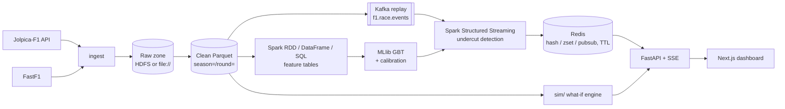

# Architecture

This is a skeleton. Each section is filled in by the step that builds that layer (see [traceability.md](traceability.md)).



## Modules (`src/f1sa/`)
| Package | Responsibility |
|---|---|
| `ingest` | Jolpica client (rate-limited, cached, resumable) and FastF1 loader |
| `lake` | Paths, schemas and writers for the raw and clean zones |
| `etl` | Spark jobs that demonstrate the RDD, DataFrame and SQL APIs |
| `features` | Gap change, tyre age, out-lap pace, pit loss, telemetry aggregates, undercut label |
| `model` | Chronological split, GBT training, calibration, explanation, baselines |
| `streaming` | Kafka producer (race replay), Structured Streaming job, Redis sink |
| `serving` | Redis key contract and store (TTL on session end) |
| `sim` | What-if race simulation (pit now / pit next lap / stay out) |
| `api` | FastAPI routes and the SSE stream for the dashboard |

## Rules
- Storage root comes **only** from `f1sa.config.Settings.data_lake_uri`. No other module hardcodes paths or endpoints.
- Features for lap *L* use only information available at the end of lap *L-1* (see `docs/label_definition.md`).
- Data is split chronologically: train on 2021–2023, validate and calibrate on 2024, test on 2025.

## Local infrastructure (Docker Compose)
Defined in `docker-compose.yml`, project name `f1sa`. `make up` starts `core`; `make up-full` starts `full` (core + hdfs + spark). `make down` stops all containers and **keeps volumes**. `make nuke CONFIRM=yes` is the only target that deletes volumes.

| Profile | Service | Image | Host port | Internal address |
|---|---|---|---|---|
| core | kafka (KRaft, single node) | `apache/kafka:4.3.2` | 9092 (`PLAINTEXT_HOST`) | `kafka:29092` |
| core | kafka-init (one-shot: creates `f1.race.events`, 3 partitions) | `apache/kafka:4.3.2` | n/a | n/a |
| core | redis (no persistence, `maxmemory 256mb`, `volatile-ttl`) | `redis:8.10.3` | 6379 | `redis:6379` |
| core | app (Python 3.12 + locked deps + Spark Kafka connector) | `f1sa-app:dev` (from `docker/spark/Dockerfile`) | n/a | n/a |
| hdfs | namenode | `f1sa-hadoop:3.4.3` (from `apache/hadoop:3.4.3`) | 9870 (web UI) | `hdfs://namenode:8020` |
| hdfs | datanode | `f1sa-hadoop:3.4.3` | n/a | `datanode:9864` |
| hdfs | httpfs (HDFS REST gateway that proxies bytes, used by the HDFS sink) | `f1sa-hadoop:3.4.3` | 14000 | `http://httpfs:14000/webhdfs/v1` |
| spark | spark-master (standalone) | `f1sa-app:dev` | 8080 (UI) | `spark://spark-master:7077` |
| spark | spark-worker-1, spark-worker-2 | `f1sa-app:dev` | 8081, 8082 (UI) | n/a |

- Host ports 3000 and 8000 are reserved for the web app and the API (later steps). Every host port can be overridden in `.env` (see `.env.example`). If you change `KAFKA_HOST_PORT` or `REDIS_HOST_PORT`, update `KAFKA_BOOTSTRAP` and `REDIS_URL` to match.
- The app image installs `spark-sql-kafka-0-10_2.13:4.2.1` (plus `kafka-clients`, `spark-token-provider-kafka` and `commons-pool2`) into `$SPARK_HOME/jars` at build time, so Structured Streaming needs no network at runtime. Inside containers, Kafka is `kafka:29092`. From the host, it is `localhost:9092`.
- HDFS is a single-node dev setup: `dfs.replication=1` and permissions disabled (`docker/hadoop/`). The NameNode is formatted on first start only.
- The app container mounts the repo read-only at `/workspace`, with `data/`, `results/` and `models/` (Step 9c) mounted read-write over it.

### Memory budget
The Docker Desktop WSL 2 VM is capped by `memory=` in the Windows file `%UserProfile%\.wslconfig`. On the dev machine the VM currently has about 9 GiB and 6 CPUs (`free -g`, `nproc`). Each container has a hard `mem_limit`:

| Container | Limit | Notes |
|---|---|---|
| kafka | 768 MiB | JVM heap 512 MiB |
| kafka-init | 512 MiB | exits after creating the topic |
| redis | 384 MiB | dataset capped at 256 MiB (`maxmemory`) |
| app | 1.5 GiB | driver for local Spark jobs |
| namenode | 768 MiB | heap ≤ 512 MiB |
| datanode | 768 MiB | heap ≤ 512 MiB |
| httpfs | 384 MiB | heap ≤ 256 MiB |
| spark-master | 512 MiB | daemon heap 256 MiB |
| spark-worker-1, -2 | 1.5 GiB each | `SPARK_WORKER_MEMORY=1g` for executors + 256 MiB daemon |
| **core total** | **≈ 2.6 GiB** | |
| **full total** | **≈ 8.0 GiB** (limits) | measured idle use is ≈ 1.6 GiB (before httpfs) |

These are ceilings, not reservations. If the full profile runs into memory pressure, lower `SPARK_WORKER_MEMORY` and `SPARK_WORKER_CONTAINER_MEM` in `.env`, or raise `memory=` in `.wslconfig` and run `wsl --shutdown`.

## Ingestion (`src/f1sa/ingest/`)
`f1sa-ingest season-range --seasons 2021-2025 --sources jolpica,fastf1 --sink file|hdfs [--dry-run] [--only-failed]`
(`f1sa-ingest race --season S --round R ...` is the same code path limited to one round).

### Raw zone layout (table first, Hive-style partitions)
Root = `DATA_LAKE_URI` (`file://./data/lake` or `hdfs://namenode:8020/f1`).
```
raw/jolpica/schedule/season=S/schedule.json                  # season-level: fetched once per season
raw/jolpica/drivers/season=S/drivers.json
raw/jolpica/constructors/season=S/constructors.json
raw/jolpica/results/season=S/round=R/results.json            # per race weekend
raw/jolpica/qualifying/season=S/round=R/qualifying.json
raw/jolpica/pitstops/season=S/round=R/pitstops.json
raw/jolpica/laps/season=S/round=R/laps.json
raw/jolpica/sprint_results/season=S/round=R/sprint_results.json   # sprint weekends only
raw/fastf1/laps/season=S/round=R/laps.parquet
raw/fastf1/session/season=S/round=R/session.json
raw/fastf1/telemetry/season=S/round=R/driver=VER/car_data.parquet  # Speed, Throttle, Brake, nGear, RPM
raw/fastf1/position/season=S/round=R/driver=VER/position.parquet
```
- Jolpica files are the JSON pages exactly as received (`[page, page, ...]`). The `parse_*` functions in
  `jolpica_client.py` turn them into typed DataFrames.
- Every partition has a `_manifest.json` with the files, rows, sha256, source URL, licence and `is_synthetic=false`.
- Each table is its own partitioned dataset, so Spark (S5/S6) can read `raw/<source>/<table>/` directly.

### Sinks (`ingest/sinks.py`)
Both sinks have the same interface (`write_bytes/json/parquet`, `write_manifest`, `exists`, `cleanup_temp`) and the
same guarantees:
- **Atomic.** Bytes go to a temporary name and are renamed onto the final name only when complete.
- **Repeatable.** Writing a name again replaces the file.
- **Verifiable.** Each write returns size and sha256 to the ingestion manifest.
- **Clean.** Temp files are removed on any failure, including Ctrl+C. `cleanup_temp()` removes leftovers from a
  killed process before a partition is rewritten.

| Sink | Temp name | Commit | Notes |
|---|---|---|---|
| `FileSink` (`file://`) | `.<name>.<random>.tmp` | fsync, then `os.replace` | files are mode 0644 |
| `HdfsSink` (`hdfs://`) | `_tmp.<uuid>.<name>` | `CREATE ...&data=true`, length check, then (`DELETE` old) + `RENAME` | via **HttpFS** |

`HdfsSink` details:
- It talks to the HttpFS gateway (`HDFS_HTTPFS_URL`: `http://localhost:14000` from the host, `http://httpfs:14000` in
  containers). HttpFS streams the bytes itself, so clients never follow WebHDFS redirects to `datanode:9864`, which the
  WSL host cannot resolve.
- Verified on 3.4.3: `RENAME` onto an existing file answers HTTP 200 with `{"boolean": false}`, and
  `renameoptions=OVERWRITE` is ignored. Replacing a file is therefore DELETE + RENAME, and the boolean is always checked.
- Connection errors and 5xx (for example NameNode safe mode) are retried with exponential backoff. 4xx fails
  immediately.
- The `hdfs://host:port` authority in `DATA_LAKE_URI` only names the path. HttpFS uses its own configured
  `fs.defaultFS`.
- `--sink` must match the scheme of `DATA_LAKE_URI`, for example
  `DATA_LAKE_URI=hdfs://namenode:8020/f1 f1sa-ingest ... --sink hdfs`.

### Ingestion manifest (`data/manifest.json`, `ingest/manifest.py`)
- One item per `sink:source:season:round` (or `...:season` for the season tables). Each item holds its status
  (`pending/running/done/failed/interrupted/skipped`), attempts, timestamps, error text (≤ 2 KB) and its files
  (URI, rows, bytes, sha256).
- The manifest is rewritten atomically after **every** status change (temp file, fsync, `os.replace`, then fsync of the
  directory). A kill at any moment leaves the old or the new version, never a torn file. This is tested with a real
  SIGKILL.
- An item still `running` on load belongs to a dead process and is retried.
- `flock` on `manifest.json.lock` stops concurrent runs.
- Resume:
  - The default run processes everything that isn't `done`.
  - `--only-failed` processes `failed` items only.
  - Races not yet run (race date ≥ today) are `skipped` and picked up later.
- Failures:
  - `FastF1AuthError` or `FastF1RateLimitError` aborts the run at once (exit 3). Sign-in is checked before any work.
  - Any other per-item error is recorded and the run continues (exit 1).
  - Ctrl+C or SIGTERM marks the item `interrupted` and exits 130.
  - Items are fetched and validated completely before their first file is written.

### Rate budget
- **Jolpica** allows 4 req/s and 500 req/h per IP. `DualRateLimiter` sits in the transport adapter, so cache hits
  are free:
  - **Per second:** a token bucket with capacity 1, refilled at 3/s, gives at most 4 requests in *any* 1-s window.
  - **Per hour:** a sliding-window log gives at most `JOLPICA_MAX_PER_HOUR` (default 450) in *any* rolling hour. It is
    persisted to `JOLPICA_CACHE_DIR/requests.log`, so resumed and back-to-back runs share one hourly budget.
  - Why not plain token buckets: a bucket of capacity C refilled at R admits C + R·T requests in a window T. The
    Step 3 buckets (4 + 4/s and 450 + 450/h) allowed 8 requests in one second and about 900 in the first hour. The
    real 2021 run hit 63 HTTP 429s from the per-second case before this was fixed.
  - A 429 without `Retry-After` backs off 5, 10, 20, 40 s (capped at 60 s). 5xx and connection errors back off from
    1 s. `Retry-After` is honoured when sent.
  - The SQLite HTTP cache at `JOLPICA_CACHE_DIR` never expires. Pages are `limit=100` (the server caps it); for laps,
    `total` counts *timings*, so pages split laps and are merged by lap number.
- **FastF1** makes its own Jolpica calls (about 3 per race) and about 10 livetiming calls per race. It also raises
  at its own hard limits (200/h jolpi.ca, 500/h overall).
- When **both** sources run:
  - Our Jolpica client gets `450 − 3 × FASTF1_MAX_RACES_PER_HOUR` (default 390/h).
  - FastF1 races are paced to `FASTF1_MAX_RACES_PER_HOUR` (default 20).
  - The passes run one after the other (all Jolpica, then FastF1).
- The plan and the budget split are printed before every run. `--dry-run` stops there. Its only network use is at most
  one schedule request per season.

### FastF1 specifics (`ingest/fastf1_loader.py`)
- `Cache.configure(cache_dir=FASTF1_CACHE_DIR)`, which **must be inside `./data`** (enforced). Nothing from FastF1 is
  written outside `data/` locally.
- The F1 TV token stays at FastF1's default `~/.local/share/fastf1/` (deny-listed for the assistant, never in the repo,
  never mounted into containers).
- Empty laps raise `FastF1AuthError`. Missing telemetry or columns raise `FastF1DataError`.
- Races are loaded and written one at a time, one driver partition after another. The session is dropped and
  `gc.collect()` runs before the next race, so at most one race is in memory.

## Sample mode (`data/sample/`, Step 4B)
- `make sample-data` validates the bundle **offline**, or builds it if it is missing (`REBUILD=1` to force).
- The bundle is a mini raw lake with the raw-zone layout: real Jolpica pages for 2023 R5 and 2024 R5 plus
  **SYNTHETIC** `raw/synthetic/{tyre_stints,lap_telemetry}` (`is_synthetic=true`, seeded, deterministic). It contains
  no FastF1 data and is under 5 MB (about 0.5 MB). See `docs/data_dictionary.md`.
- Building reads each page from the raw zone, then the HTTP cache, then the network. The network path goes through
  the shared, flock-protected rate-limit log, so it is safe next to a running bulk ingestion. The bundle is assembled
  in `data/sample.tmp-<pid>`, validated, then swapped in.
- Validation checks sha256 and size, schemas, `is_synthetic`, no FastF1, unlisted files and the size limit, and that
  the synthetic tables regenerate byte-identically from the recorded seed.
- Consumers read the bundle read-only and write elsewhere. For example, the clean job's `--source sample` writes to
  `{DATA_LAKE_URI}/clean`, so derived output never lands in the tracked `data/sample/`.

## Clean zone (`etl/clean.py`, `lake/schemas.py`, `lake/quality.py`, Step 5)
```
raw (Jolpica JSON pages, FastF1 Parquet, synthetic Parquet)
  --Spark: explicit schemas, explode, normalise ids, times -> seconds, gaps, track flags-->
clean/{races,drivers,constructors,results,qualifying,laps,pitstops,stints,telemetry_lap,telemetry_raw}/season=S/round=R/
  + clean/_quality/report.json
```
- **Input**:
  - `--source sample` reads `data/sample/raw` (read-only).
  - `--source lake` reads `{DATA_LAKE_URI}/raw` (file:// or hdfs://).
  - FastF1 data is optional and used per race when present (exact track status, real stints and telemetry).
- **Output**: `{DATA_LAKE_URI}/clean/{table}/`, Parquet, `partitionBy("season","round")`, `mode=overwrite` with
  `spark.sql.sources.partitionOverwriteMode=dynamic`.
  - A rerun replaces only the partitions it writes, so it is **idempotent**: identical per-table content checksums
    are printed and stored in the report.
  - A run over a subset of races leaves the other partitions untouched.
  - In file mode the job refuses to write outside `./data/lake` (gitignored), and Spark scratch goes to
    `data/lake/.spark-tmp`.
- **Reading pandas Parquet**: `spark.sql.legacy.parquet.nanosAsLong=true` lets Spark read FastF1's nanosecond
  timestamps and durations as `long`; the job converts them explicitly.
- **Quality**: hard checks fail the job (exit 1), and soft checks are reported. See `docs/data_dictionary.md`.
- **Run modes**:
  - **file, on the host**: `make etl-sample`, or
    `DATA_LAKE_URI=file://$PWD/data/lake uv run python -m f1sa.etl.clean --source sample`. Spark runs `local[2]`.
  - **hdfs, inside the app container**. The container can resolve `namenode` and `datanode`; the host cannot:
    ```bash
    docker compose exec app env PYTHONPATH=/workspace/src DATA_LAKE_URI=hdfs://namenode:8020/f1 \
        python -m f1sa.etl.clean --source lake
    ```
    `PYTHONPATH` points at the mounted repo (`/workspace`, read-only), so the current code runs without rebuilding
    the image. Spark runs `local[2]` inside the 1.5 GiB app limit. `--master spark://spark-master:7077` switches to
    the standalone cluster (planned for S10). *Not verified yet: waiting for the bulk HDFS ingest to finish.*

## Feature jobs (`etl/rdd_jobs.py`, `etl/df_jobs.py`, `etl/sql/*.sql`, `etl/sql_jobs.py`, `features/`, Step 6)
```
clean/{races,drivers,constructors,results,laps,pitstops,stints}   (one directory per table; _quality/ is never read)
  --RDD / DataFrame / Spark SQL-->
features/{laps_enriched,gaps,stints,lap_time_distribution,pit_loss,team_outlap_history,race_summary}/season=S/round=R/
```
`uv run python -m f1sa.features.build --source sample` (or `make features-sample`, or `f1sa-features`).

- `--source sample` builds the races in `data/sample` and fails if one of them is missing from the clean zone
  (run `make etl-sample` first). `--source lake` builds every race in the clean zone.
- Output uses `partitionBy(season, round)` with dynamic overwrite, so a rerun gives identical checksums. In file mode
  the job refuses to write outside `./data/lake`.
- Every table is read back after writing, and the job checks that each target race has a partition and that
  `laps_enriched` has exactly one row per clean lap.

### Where each Spark API is used, and why
| API | Job | Why this API |
|---|---|---|
| **RDD** | `rdd_stints`: `keyBy((season, round, driver))`, then `groupByKey`, then a Python sort of each driver's laps and a split after every pit-in lap that is not the last lap | Stint splitting is a sequential scan over one driver's ordered laps. With an RDD, that is ordinary Python code over a grouped iterator, with no window tricks. One driver has at most about 70 laps, so `groupByKey` is cheap here. |
| **RDD** | `rdd_lap_time_distribution`: `aggregateByKey` over (season, round, circuit) with a custom accumulator (n, mean, M2, min, max, 1-s histogram), combined with Chan's parallel update | It shows a user-defined, mergeable aggregate: partial results are combined on each partition before the shuffle. Welford/Chan keeps the variance stable. The circuit lookup is a broadcast variable. |
| **DataFrame** | `enrich_laps`: joins of laps, results, pit stops (aggregated per lap first), drivers, constructors, stints (a range join on `lap BETWEEN start_lap AND end_lap`) and races; windows for cumulative time, gaps, `lag` changes, tyre age and laps remaining | These are relational joins and window functions, which Catalyst optimises (column pruning, broadcast joins of the small dimension tables, a shared window sort). Every right side is deduplicated on its join key, so the output has exactly one row per lap. |
| **Spark SQL** | `pit_loss_prior`, `team_outlap_prior`, `race_summary` (and the views they build on) | The rules against leakage sit in one readable window frame, `RANGE BETWEEN UNBOUNDED PRECEDING AND 1 PRECEDING` over `race_seq = season*100 + round`. A reviewer can audit that in the `.sql` file without reading Python. |

Each RDD job has a DataFrame implementation of the same logic (`df_stints`, `df_lap_time_distribution`). The tests
assert that the two are equal row for row:
- stints: exact equality, and both also equal the clean stints table on the sample (100/100 rows);
- the distribution: counts, min, max and histograms are exact, and mean and std agree to 1e-9 relative, because
  floating-point sums depend on the order of addition.

### Gaps at the timing line
- `gap_leader_s` = cumulative time − the cumulative time of the car in P1 **at the same lap number**.
  - A lapped car is compared with the time when the leader completed that same lap, not with the leader's position
    when the lapped car crossed the line.
  - So the value is the true time behind and can be longer than a lap. For example, a car lapped at lap 4 is 106 s
    behind in the test fixture, where a lap takes 90 s.
- `gap_ahead_s` is the gap to the car one position ahead at the same lap number. `ahead_driver_id` names that car.
- `gap_*_change_{1,3}l` is the value now minus the value k laps earlier.
  - It is null when the earlier row is not exactly lap − k.
  - For `gap_ahead_change_*`, it is also null when the car ahead is a different driver, so the change always means
    "closing on, or dropping back from, the same car".
- Cumulative time becomes null from the first lap with an unknown time, and every gap that depends on it is null
  too.
- The recomputed gaps equal the clean-zone gaps exactly on the sample (2168/2168 laps).

### Estimated lap timestamps (an approximation)
Jolpica has no per-lap timestamps. `df_jobs.lap_timestamps` estimates them:
```
lap_end_utc   = race_start_utc + START_OFFSET_S + cumulative_time_s      (START_OFFSET_S = 180 s)
lap_start_utc = lap_end_utc - lap_time_s
```
`lap_time_estimated = true` on every row. `race_start_utc` is the scheduled start, which is when the formation lap
begins. Lights out is usually about 2.5 to 4 minutes later, so 180 s is a fixed middle value. Limits:
- **Error of about ±1 minute or more:**
  - the formation lap takes longer or shorter than 180 s;
  - extra formation laps, aborted starts and delayed starts are not modelled;
  - a start behind the safety car changes the timing.
- **Red flags:** Jolpica's lap time for the suspended lap includes the stoppage, so later timestamps stay roughly
  consistent with the wall clock. The exact split inside that lap is unknown.
- **Unknown start time:** Jolpica sometimes has no start time, and the clean zone then stores 00:00:00 UTC. Both
  timestamps are null in that case, as they are when the cumulative time is unknown.
- **Precision:** inherited from the 1 ms lap times. Errors from missing laps add up, which is why the cumulative time
  is null after a missing lap.
- **Intended use:** ordering and replay pacing (S12). They are not wall-clock truth. FastF1's `LapStartTime` is exact
  when it is available.

### Leakage-safe history (pit loss, team out-lap delta)
- **Per stop** (`pit_cycles.sql`):
  - Pit loss = in-lap + out-lap − 2 × the driver's green median lap. The green median comes from
    `driver_green_pace.sql` and needs at least 5 green laps.
  - Out-lap delta = out-lap − the driver's green median lap.
  - Stops are skipped when:
    - the stop is long (more than 60 s);
    - it is on lap 1;
    - there is no out-lap (a stop on the last lap, or a retirement);
    - the in-lap or out-lap is neutralised or red-flag;
    - the in-lap or out-lap overlaps another pit cycle;
    - a lap time is unknown;
    - the driver has no reference pace.
- **Per race:**
  1. Each race (or each race and constructor) gets one row with its own values in an array.
  2. `flatten(collect_list(vals)) OVER (… ORDER BY race_seq RANGE BETWEEN UNBOUNDED PRECEDING AND 1 PRECEDING)`
     collects the values of strictly earlier races only.
  3. The median of the sorted array is taken with the same linear interpolation as Spark's `median`.

  Spark does not allow `median()` with a window frame, which is why the arrays are used.
- **Fallbacks** use data from earlier races only, never from the current race or a later one:

  | Table | Fallback order | Flag columns |
  |---|---|---|
  | `pit_loss` | circuit prior → global prior → null | `pit_loss_source ∈ {circuit_prior, global_prior, none}`, `pit_loss_missing` |
  | `team_outlap_history` | team prior → circuit prior (all teams) → global prior → null | `outlap_source ∈ {team_prior, circuit_prior, global_prior, none}`, `outlap_missing` |

- History is computed over **all** races in the clean zone and then filtered to the target races. A partial rebuild
  therefore gives the same values as a full one.
- On the sample:
  - 2023 R5 (miami) → `none`.
  - 2024 R5 (shanghai, a new circuit) → `global_prior`, from 2023 R5 only.
  - Team out-laps for 2024 → `team_prior`. Renamed teams (alphatauri → rb, alfa → sauber) get `global_prior`,
    because `constructor_id` changes on a rename.
- Tests: a 4-race fixture with known medians. The data of the target race and every later race is scaled ×100, and
  the target's history is asserted unchanged.

### Time semantics for the model (S8)
A feature row for lap L describes the state **at the end of lap L**. The undercut model must use the information
available at the end of lap L − 1, so it joins the lap L − 1 row (gaps, tyre age, laps remaining). Pit-loss and
out-lap history rows are known before the race starts. `race_summary` and `lap_time_distribution` describe the whole
race, so they are reporting tables and must never be joined as features of the same race.

## Telemetry, out-lap pace and team lineage (`features/telemetry_agg.py`, `outlap.py`, `lineage.py`, Step 7)
- **Telemetry is batch only.** `telemetry_agg` is a DataFrame `groupBy(season, round, driver_id, lap)` job.
  - There is one definition, at full throttle ≥ 98%. The clean zone's FastF1 path calls it too, so the clean and
    feature tables cannot disagree.
  - Samples are assigned to laps by session time in `[lap_start, lap_end)`. The windows come from the new nullable
    clean-laps columns `lap_start_session_s` and `lap_end_session_s`, filled from FastF1.
  - A race with real `telemetry_raw` is aggregated from raw. Any other race passes its clean `telemetry_lap` rows
    through unchanged, keeping `is_synthetic`.
  - Streaming code never imports telemetry, and a test enforces this.
- **Out-lap pace** (definitions in `docs/label_definition.md`):
  - `realised_outlap_delta_s` is an ORACLE value (it uses laps after the stop).
  - `expected_outlap_delta_s` is the decision-time feature: the mean over strictly earlier races, computed with
    `rangeBetween(unboundedPreceding, -1)` on `race_seq`.
  - Fallback order: driver+team → team → circuit → global → null, with a flag column.
  - Like Step 6, history is computed over all clean races and then filtered to the targets.
- **Lineage:** `features/lineage.py` holds `LINEAGE` (alphatauri → rb, alfa → sauber) and `STABLE_CONSTRUCTORS`.
  - Team history (the SQL `team_outlap_history` through a `constructor_lineage` view, and `outlap_features` through
    `with_history_key`) is keyed by the lineage key.
  - The build fails when a clean-zone constructor id is in neither set, so a missed rename cannot silently split a
    team's history.
  - The list is verified on the sample only. It is to be checked against the full 2021–2025 data.

## Undercut attempts and the real-time detector (`features/undercut_rule.py`, `undercut.py`, `streaming/detector.py`, Step 8)
- **One rule, two callers.** `features/undercut_rule.py` is pure Python, with no Spark, pandas or py4j import (a
  subprocess test enforces this). `candidate_pairs(LapSnapshot, RuleParams)` returns every candidate pair at the end of
  a lap, with the reasons it fails:
  - `streaming/detector.detect` keeps the eligible pairs (opportunities before any stop);
  - `features/undercut.evaluate_race` keeps the pairs whose attacker pits on the next lap and evaluates the outcome
    window.

  `tests/unit/test_undercut.py` checks, on every scenario, lap and G, that the detector's flagged pairs (with A
  pitting on L) equal the batch attempts that have `detector_eligible`.
- **Distribution.** Per race, the batch job runs the pure-Python evaluation through the RDD API:
  `keyBy(season, round)` on the lap rows and the pit stops, `cogroup`, then `flatMap(evaluate_race)`. A race is about
  1,200 lap rows, so it fits in one task, and races are independent. Decision-time features are DataFrame windows over
  `laps_enriched` (stint-to-date pace and degradation) plus joins to `pit_loss` and `outlap_features`, made at the
  decision lap L − 1.
- **Grid.** All 9 (G, k) combinations are emitted in one run. `undercut_attempts` is a sparse table, so a target race
  with no attempts gets its stale partition deleted instead of being required.
- **Smoke-test counts.** `--source sample` also writes `results/undercut_counts_sample.csv` (smoke test only).
- **Out-lap plan size.** `outlap_features` reuses the realised out-lap table four times. A `localCheckpoint()` cuts
  its lineage; without it the optimised plan grew to about 13 MB and the test JVM ran out of heap.

## Undercut model (`model/`, `experiments/model_eval.py`, Step 9)
```
undercut_attempts + stints + telemetry_lap_features --dataset.load_attempts--> one (G, k), labelled rows
  --build_dataset--> train 2021-23 | validation 2024 | SealedSplit(test 2025)
  --train.tune (grid; fit on train, PR-AUC on validation)--> LR (assembler, scaler, LR) and GBT pipelines
  --calibrate.choose (validation scores)--> isotonic or Platt (Platt below 300 rows) or identity
  --evaluate.evaluate_test (opens the test split once)--> metrics plus race-cluster and attempt bootstrap CIs
  --explain--> GBT importances, standardised LR coefficients, validation permutation importance
```
- **Metrics** (`model/metrics.py`) are numpy, so tuning, evaluation, the bootstrap and permutation importance share
  one implementation.
  - PR-AUC is average precision; it does not interpolate like Spark's `areaUnderPR`.
  - ROC-AUC matches Spark's `areaUnderROC` exactly (tested).
- **Refit policy.** The chosen grid point is the model fitted on train only, so validation stays out of sample for
  calibration. There is no CrossValidator across time.
- **Sources** (`model/pipeline.py`):

  | Source | What runs | Output suffix and stamp |
  |---|---|---|
  | `sample` | the real sample features; the test step is skipped | `_sample`, SMOKE TEST |
  | `rehearsal` | GENERATED 2021–2025 data, the whole pipeline (never reads the lake) | `_rehearsal`, REHEARSAL |
  | `full` | the whole lake; needs `--allow-test-season` | no suffix |

- **Outputs:** `results/{model_eval,calibration,feature_importance}*.csv` and
  `results/{reliability,confusion_matrix,feature_importance}*.png`. Models go to
  `models/undercut/{source}_{feature_set}_G{g}_k{k}/{lr,gbt}` (gitignored) with `metadata.json`: features, versions,
  seed, split counts, class weights, the grid and calibrators.

### Deployment model (`model/deploy.py`, `model/lr_scorer.py`, `experiments/model_save.py`, Step 9c)
- `make model-save-full` runs the frozen specification (`docs/model_spec.md`) once, in the app container, on the
  primary setting G=3.5, k=2. It reuses the development path unchanged: `pipeline.load_frame` in no-test mode
  (only the `season=2021..2024` partitions are listed and read), `DEV_SPLIT`, `train.tune` with the frozen grids
  and seed 42, and `calibrate.choose` (Platt, 49 validation rows). `evaluate_test` is never imported. Separate entry
  point, so `pipeline.run` and the test-season path are untouched.
- Layout (gitignored, about 280 KB). The `deploy` source token keeps it apart from the test run's
  `full_real_G*_k*` folder:
  ```
  models/undercut/deploy_real_G3.5_k2/
    lr/   pipeline/ (Spark PipelineModel)  calibrator.json  scorer.json  metadata.json
    gbt/  pipeline/                        calibrator.json                metadata.json
    reproduction.json
  ```
  Each `metadata.json` holds the features in order, the assembled columns, the feature set, G and k, the
  training and calibration seasons, the hyperparameters, the calibrator, `decision_threshold` 0.5, the seed, the
  library versions, the git sha and dirty flag, `test_season_read: false` and the partitions read.
- Writes go to `.staging-*` and are renamed into place only after the **reproduction check** passes:
  - the reloaded models predict exactly like the in-memory models;
  - the parameters, calibrator, raw validation PR-AUC and calibrated validation Brier / PR-AUC equal
    `results/model_dev_*`;
  - the Python scorer equals Spark within 1e-9.

  Otherwise exit 4 and the staging folder is kept. An existing folder is replaced only with `FORCE=1`
  (`--force`).
- **Pure-Python scorer** (`lr_scorer.LRScorer`, reads `lr/scorer.json`, no Spark or numpy import). It
  reproduces the training transforms:
  - assembler order, with 0.0 fill and a `_missing` indicator for numeric inputs;
  - one-hot plus `unknown` for categorical inputs, and NaN/inf rejected as `VectorAssembler(handleInvalid="error")`
    does;
  - the scaler `(x - mean) / std` (0 where std = 0), then the LR sigmoid, then Platt.
- **Streaming (S12) deploys the calibrated LR only**, the pre-registered primary model, via the scorer
  (microseconds per pair, no JVM round trip). GBT is saved and loadable for batch and dashboard comparison; a Spark
  `transform` per micro-batch would add a Spark job (tens to hundreds of ms) for a non-primary model.
- **How containers reach `models/`.** The app service mounts `./models:/workspace/models` read-write (the repo
  itself stays `:ro`). The API container (S13) will mount `./models:/workspace/models:ro` and load
  `lr/scorer.json` without Spark. The container has no git, so the Makefile passes `F1SA_GIT_SHA` /
  `F1SA_GIT_DIRTY`; without a sha the run refuses.

